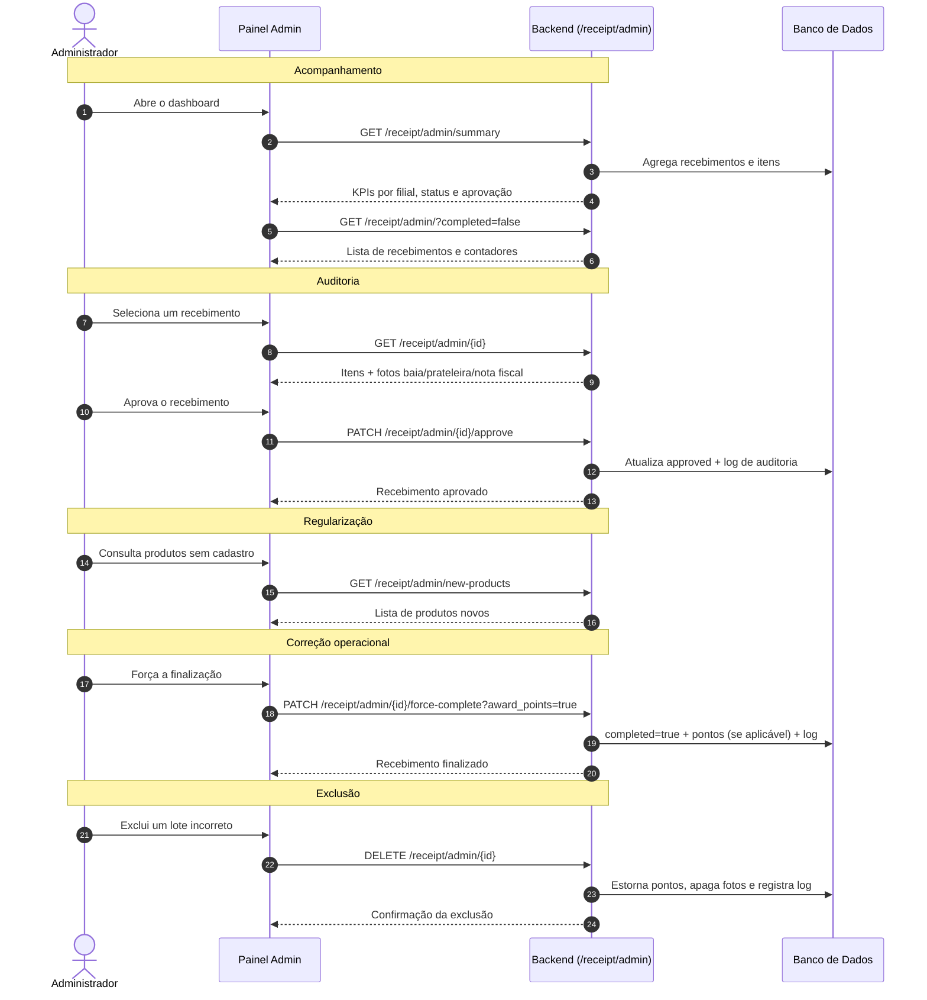

# README Exclusivo — Rota de Administração de Recebimento (`/receipt/admin`)

> **Módulo:** Administração de Recebimento de Mercadorias  
> **Prefixo:** `/receipt/admin`  
> **Arquivo:** `app/routers/receipt/admin_receipt.py`  
> **Backend:** FastAPI + SQLModel (PostgreSQL)  
> **Público-alvo:** Desenvolvedores Frontend (Web/Mobile), auditores, supervisores e DevOps  
> **Frontend Web:** o painel administrativo está documentado na seção 15 deste arquivo.

---

## 1. Visão Geral

Esta é a documentação exclusiva da rota administrativa do módulo de recebimento. Ela complementa o guia operacional `README_RECEIPT.md`, que cobre as rotas usadas pelos operadores no dia a dia.

A rota administrativa permite que usuários com perfil de administrador (`admin = 1`):

- Acompanhem indicadores consolidados de recebimento (KPIs).
- Consultem todos os recebimentos com filtros por filial, operador, data, status e aprovação.
- Abram um lote de recebimento em nome de outro operador e de outra filial.
- Consultem o detalhe completo de qualquer recebimento, com itens e fotos.
- Aprovem ou reprovem formalmente um recebimento após auditoria.
- Forcem a finalização de um recebimento pendente, com ou sem concessão de pontos.
- Identifiquem produtos novos recebidos que ainda não possuem cadastro no ERP.
- Excluam um recebimento completo, removendo itens, fotos e estornando a pontuação.

> **Importante:** todas as rotas deste módulo exigem token JWT válido **e** a claim `admin` verdadeira. Um operador autenticado recebe `403 Forbidden`.

---

## 2. Arquitetura e Registro da Rota

### 2.1 Arquivos envolvidos

| Arquivo | Responsabilidade |
| :--- | :--- |
| `app/routers/receipt/admin_receipt.py` | Define todas as rotas administrativas de recebimento. |
| `app/routers/receipt/__init__.py` | Registra o `admin_router` **antes** das rotas dinâmicas. |
| `app/models/receipt.py` | Modelos de tabela e schemas usados pelas respostas. |
| `app/routers/receipt/helpers.py` | Formatação de respostas, exclusão de fotos e utilitários. |
| `app/routers/rank/pointValidation.py` | Regra de validação diária de pontuação. |
| `main.py` | Inclui o roteador `/receipt` com a dependência `get_current_user`. |

### 2.2 Como a rota é montada

```python
# app/routers/receipt/__init__.py
router = APIRouter(prefix="/receipt", tags=["receipt"])
router.include_router(admin_router)   # prefixo interno: /admin
router.include_router(create_router)
router.include_router(delete_route)
router.include_router(get_router)
router.include_router(edit_router)
```

```python
# main.py
app.include_router(receipt.router, dependencies=[Depends(get_current_user)])
```

Resultado final dos endpoints:

```text
GET    /receipt/admin/summary
GET    /receipt/admin/new-products
GET    /receipt/admin/
GET    /receipt/admin/{receipt_id}
POST   /receipt/admin/
PATCH  /receipt/admin/{receipt_id}/approve
PATCH  /receipt/admin/{receipt_id}/force-complete
DELETE /receipt/admin/{receipt_id}
```

> O `admin_router` é incluído primeiro justamente para que rotas dinâmicas como `/receipt/{receipt_id}` não capturem o segmento `admin`.

### 2.3 Verificação de administrador

Cada endpoint chama a função interna:

```python
def check_admin(user: dict) -> None:
    if not user.get("admin"):
        raise HTTPException(
            status_code=403,
            detail="Acesso negado: apenas administradores podem acessar esta funcionalidade."
        )
```

A claim `admin` é gravada no token no momento do login (`POST /auth/login`) e extraída por `get_current_user`.

---

## 3. Autenticação

Todas as requisições precisam do cabeçalho:

```http
Authorization: Bearer <token_jwt>
Content-Type: application/json
```

### 3.1 Obter o token

```bash
curl -X POST "http://localhost:8000/auth/login" \
  -H "Content-Type: application/json" \
  -d '{"username": "admin", "password": "sua_senha"}'
```

Resposta:

```json
{
  "access_token": "eyJhbGciOiJIUzI1NiIsInR5cCI6IkpXVCJ9...",
  "token_type": "bearer"
}
```

### 3.2 Respostas de autenticação e autorização

| Situação | Status | `detail` |
| :--- | :---: | :--- |
| Token ausente ou inválido | `401` | `Token inválido` |
| Usuário autenticado sem perfil admin | `403` | `Acesso negado: apenas administradores podem acessar esta funcionalidade.` |

---

## 4. Resumo dos Endpoints

| # | Método | Endpoint | Objetivo | Admin |
| :-: | :--- | :--- | :--- | :---: |
| 1 | `GET` | `/receipt/admin/summary` | KPIs consolidados dos recebimentos. | Sim |
| 2 | `GET` | `/receipt/admin/new-products` | Produtos novos recebidos sem cadastro no ERP. | Sim |
| 3 | `GET` | `/receipt/admin/` | Listagem administrativa com filtros e paginação. | Sim |
| 4 | `GET` | `/receipt/admin/{receipt_id}` | Detalhe completo de um recebimento. | Sim |
| 5 | `POST` | `/receipt/admin/` | Abre um recebimento para outro operador/filial. | Sim |
| 6 | `PATCH` | `/receipt/admin/{receipt_id}/approve` | Aprova ou reprova um recebimento. | Sim |
| 7 | `PATCH` | `/receipt/admin/{receipt_id}/force-complete` | Força a finalização do recebimento. | Sim |
| 8 | `DELETE` | `/receipt/admin/{receipt_id}` | Exclui o recebimento, itens, fotos e pontos. | Sim |

---

## 5. Endpoints em Detalhe

### 5.1 `GET /receipt/admin/summary`

**Objetivo:** retornar métricas consolidadas para o dashboard administrativo.

**Query params:**

| Parâmetro | Tipo | Obrigatório | Descrição |
| :--- | :--- | :---: | :--- |
| `local` | `int` | Não | Filtra pela filial. |
| `start_date` | `date` (`YYYY-MM-DD`) | Não | Data inicial (inclusive). |
| `end_date` | `date` (`YYYY-MM-DD`) | Não | Data final (inclusive). |

**Exemplo de requisição:**

```bash
curl "http://localhost:8000/receipt/admin/summary?local=1&start_date=2026-10-01&end_date=2026-10-31" \
  -H "Authorization: Bearer <token>"
```

**Resposta `200 OK`:**

```json
{
  "total_receipts": 128,
  "completed_receipts": 110,
  "pending_receipts": 18,
  "approved_receipts": 95,
  "total_items_received": 1542,
  "total_units_received": 98750.5,
  "total_new_products": 12,
  "receipts_by_local": {
    "1": 80,
    "2": 48
  }
}
```

**Descrição dos campos:**

| Campo | Tipo | Descrição |
| :--- | :--- | :--- |
| `total_receipts` | `int` | Total de lotes de recebimento no filtro. |
| `completed_receipts` | `int` | Lotes finalizados (`completed = true`). |
| `pending_receipts` | `int` | Lotes ainda em andamento (`completed = false`). |
| `approved_receipts` | `int` | Lotes aprovados pela administração (`approved = true`). |
| `total_items_received` | `int` | Soma de produtos/itens registrados nos lotes. |
| `total_units_received` | `float` | Soma de `quantity_physical` de todos os itens. |
| `total_new_products` | `int` | Itens marcados como produto novo (`is_new_product = true`). |
| `receipts_by_local` | `object` | Quantidade de lotes por filial. As chaves são serializadas como string no JSON. |

---

### 5.2 `GET /receipt/admin/new-products`

**Objetivo:** listar produtos recebidos como **novos** (sem cadastro no ERP), para que o time de cadastro/compras regularize os itens.

**Query params:**

| Parâmetro | Tipo | Obrigatório | Descrição |
| :--- | :--- | :---: | :--- |
| `local` | `int` | Não | Filtra pela filial. |
| `start_date` | `date` | Não | Data inicial. |
| `end_date` | `date` | Não | Data final. |
| `limit` | `int` | Não | Máximo de registros (1 a 500, padrão `100`). |
| `offset` | `int` | Não | Deslocamento da paginação (padrão `0`). |

**Exemplo de requisição:**

```bash
curl "http://localhost:8000/receipt/admin/new-products?local=1&limit=50&offset=0" \
  -H "Authorization: Bearer <token>"
```

**Resposta `200 OK`:**

```json
[
  {
    "id": 16,
    "receipt_id": 42,
    "local": 1,
    "product_code": "7891234567890",
    "product_name": "NOVO BISCOITO ARTESANAL 200G",
    "quantity_physical": 50.0,
    "received_quantity": 50.0,
    "invoice_photo": "/uploads/receipts/items/16/invoice_a9b8c7d6e5f4.jpg",
    "user_id": 3,
    "user_name": "Carlos Silva",
    "received_at": "2026-10-24T11:00:00Z",
    "observations": "Produto novo - aguardando cadastro no ERP",
    "dock_photos": [
      {
        "id": 101,
        "photo_type": "dock",
        "filename": "dock_a1b2c3d4e5f6.jpg",
        "url": "/uploads/receipts/items/16/dock_a1b2c3d4e5f6.jpg",
        "created_at": "2026-10-24T11:00:02Z"
      }
    ],
    "shelf_photos": [
      {
        "id": 102,
        "photo_type": "shelf",
        "filename": "shelf_f6e5d4c3b2a1.jpg",
        "url": "/uploads/receipts/items/16/shelf_f6e5d4c3b2a1.jpg",
        "created_at": "2026-10-24T11:00:04Z"
      }
    ]
  }
]
```

**Ordenação:** do item mais recente (`ReceiptItem.id DESC`) para o mais antigo.

---

### 5.3 `GET /receipt/admin/`

**Objetivo:** listagem administrativa completa de recebimentos, com contadores de itens, volume físico e quantidade de produtos novos.

**Query params:**

| Parâmetro | Tipo | Obrigatório | Descrição |
| :--- | :--- | :---: | :--- |
| `local` | `int` | Não | Filtra pela filial. |
| `user_id` | `int` | Não | Filtra pelo operador responsável. |
| `date` | `date` (`YYYY-MM-DD`) | Não | Filtra por data exata do recebimento. |
| `start_date` | `date` | Não | Data inicial. |
| `end_date` | `date` | Não | Data final. |
| `completed` | `bool` | Não | `true` = finalizados; `false` = abertos. |
| `approved` | `bool` | Não | `true` = aprovados; `false` = não aprovados. |
| `limit` | `int` | Não | Máximo de registros (1 a 500, padrão `100`). |
| `offset` | `int` | Não | Deslocamento da paginação (padrão `0`). |

**Exemplo de requisição:**

```bash
curl "http://localhost:8000/receipt/admin/?local=1&completed=false&approved=false&limit=20&offset=0" \
  -H "Authorization: Bearer <token>"
```

**Resposta `200 OK`:**

```json
[
  {
    "id": 42,
    "user_id": 3,
    "user_name": "Carlos Silva",
    "quantity": 2,
    "local": 1,
    "created_date": "2026-10-24",
    "time_stamp": "2026-10-24T08:15:00Z",
    "completed": false,
    "completed_at": null,
    "approved": false,
    "photo": null,
    "observations": "Recebimento matutino",
    "items_count": 2,
    "total_physical_quantity": 74.0,
    "new_products_count": 1
  }
]
```

**Ordenação:** `created_date DESC`, depois `id DESC`.

---

### 5.4 `GET /receipt/admin/{receipt_id}`

**Objetivo:** retornar o detalhe completo de um recebimento para auditoria administrativa, com todos os itens e fotos.

**Path params:**

| Parâmetro | Tipo | Descrição |
| :--- | :--- | :--- |
| `receipt_id` | `int` | ID do lote de recebimento. |

**Exemplo de requisição:**

```bash
curl "http://localhost:8000/receipt/admin/42" \
  -H "Authorization: Bearer <token>"
```

**Resposta `200 OK`:**

```json
{
  "id": 42,
  "user_id": 3,
  "user_name": "Carlos Silva",
  "quantity": 2,
  "local": 1,
  "created_date": "2026-10-24",
  "time_stamp": "2026-10-24T08:15:00Z",
  "completed": true,
  "completed_at": "2026-10-24T17:40:00Z",
  "approved": true,
  "photo": null,
  "observations": "Recebimento matutino",
  "items_count": 2,
  "total_physical_quantity": 74.0,
  "items": [
    {
      "id": 15,
      "receipt_id": 42,
      "product_code": "10628",
      "is_new_product": false,
      "product_name": "BARRA CEREAL BRIGADEIRO TRIO CX 24 PCT 3 UN 20 G",
      "quantity_system": 12.0,
      "quantity_physical": 24.0,
      "difference": 12.0,
      "received_quantity": 24.0,
      "invoice_photo": "/uploads/receipts/items/15/invoice_a9b8c7d6e5f4.jpg",
      "user_id": 3,
      "user_name": "Carlos Silva",
      "received_at": "2026-10-24T10:30:00Z",
      "observations": "Caixas íntegras",
      "dock_photos": [
        {
          "id": 101,
          "photo_type": "dock",
          "filename": "dock_a1b2c3d4e5f6.jpg",
          "url": "/uploads/receipts/items/15/dock_a1b2c3d4e5f6.jpg",
          "created_at": "2026-10-24T10:30:02Z"
        }
      ],
      "shelf_photos": [
        {
          "id": 102,
          "photo_type": "shelf",
          "filename": "shelf_f6e5d4c3b2a1.jpg",
          "url": "/uploads/receipts/items/15/shelf_f6e5d4c3b2a1.jpg",
          "created_at": "2026-10-24T10:30:04Z"
        }
      ]
    }
  ]
}
```

**Erros:**

| Status | `detail` |
| :---: | :--- |
| `404` | `Recebimento não encontrado` |

---

### 5.5 `POST /receipt/admin/`

**Objetivo:** abrir um novo lote de recebimento designando o operador responsável e a filial. O administrador não se torna o operador do lote; o vínculo é feito com o usuário informado.

**Content-Type:** `application/json`

**Body:**

| Campo | Tipo | Obrigatório | Descrição |
| :--- | :--- | :---: | :--- |
| `user_id` | `int` | **Sim** | ID do operador que ficará responsável pelo recebimento. |
| `local` | `int` | **Sim** | ID/código da filial. |
| `created_date` | `date` | Não | Data do recebimento. Padrão: data atual UTC. |
| `observations` | `string` | Não | Observações gerais. Se omitida, o backend registra quem criou. |

**Exemplo de requisição:**

```bash
curl -X POST "http://localhost:8000/receipt/admin/" \
  -H "Authorization: Bearer <token>" \
  -H "Content-Type: application/json" \
  -d '{
    "user_id": 3,
    "local": 2,
    "created_date": "2026-10-30",
    "observations": "Carga agendada para as 08h"
  }'
```

**Resposta `200 OK`:** objeto `ReceiptRead` (mesmo formato do endpoint 5.4), com `items` vazio no momento da criação.

```json
{
  "id": 43,
  "user_id": 3,
  "user_name": "Carlos Silva",
  "quantity": 0,
  "local": 2,
  "created_date": "2026-10-30",
  "time_stamp": "2026-10-30T08:00:00Z",
  "completed": false,
  "completed_at": null,
  "approved": false,
  "photo": null,
  "observations": "Carga agendada para as 08h",
  "items_count": 0,
  "total_physical_quantity": 0.0,
  "items": []
}
```

**Regras e erros:**

| Status | `detail` |
| :---: | :--- |
| `404` | `Usuário designado não encontrado` |

- Registra log de auditoria com ação `Cadastrar`.
- A descrição do log inclui o ID do recebimento, a filial e o nome do operador designado.
- Se `observations` não for enviada, o backend grava: `Recebimento criado pelo administrador {nome_do_admin}`.

---

### 5.6 `PATCH /receipt/admin/{receipt_id}/approve`

**Objetivo:** aprovar ou reprovar formalmente um recebimento após conferência física e fotográfica.

**Path params:**

| Parâmetro | Tipo | Descrição |
| :--- | :--- | :--- |
| `receipt_id` | `int` | ID do lote de recebimento. |

**Body:**

| Campo | Tipo | Obrigatório | Descrição |
| :--- | :--- | :---: | :--- |
| `approved` | `bool` | Não | `true` aprova (padrão); `false` reprova. |
| `observations` | `string` | Não | Justificativa/observação da auditoria. É anexada às observações do lote. |

**Exemplo de requisição:**

```bash
curl -X PATCH "http://localhost:8000/receipt/admin/42/approve" \
  -H "Authorization: Bearer <token>" \
  -H "Content-Type: application/json" \
  -d '{
    "approved": true,
    "observations": "Fotos da baia e da prateleira em conformidade."
  }'
```

**Resposta `200 OK`:** objeto `ReceiptRead` atualizado.

**Regras:**

- Aprovar/reprovar é independente de o lote estar finalizado (`completed`).
- A observação enviada é gravada no formato:
  `[Auditoria Admin {nome_do_admin}]: {observations}`.
- Se já existirem observações no lote, o texto é concatenado com ` | `.
- Registra log de auditoria com ação `Aprovar Recebimento` ou `Desaprovar Recebimento`.

**Erros:**

| Status | `detail` |
| :---: | :--- |
| `404` | `Recebimento não encontrado` |

---

### 5.7 `PATCH /receipt/admin/{receipt_id}/force-complete`

**Objetivo:** forçar a finalização de um recebimento pendente. Útil quando o operador esqueceu de finalizar o lote no fim do expediente.

**Path params:**

| Parâmetro | Tipo | Descrição |
| :--- | :--- | :--- |
| `receipt_id` | `int` | ID do lote de recebimento. |

**Query params:**

| Parâmetro | Tipo | Obrigatório | Descrição |
| :--- | :--- | :---: | :--- |
| `award_points` | `bool` | Não | `true` (padrão) concede os +10 pontos de ranking ao operador; `false` finaliza sem pontuar. |

**Exemplo de requisição:**

```bash
# Finaliza e concede os pontos
curl -X PATCH "http://localhost:8000/receipt/admin/42/force-complete?award_points=true" \
  -H "Authorization: Bearer <token>"

# Finaliza sem conceder pontos
curl -X PATCH "http://localhost:8000/receipt/admin/42/force-complete?award_points=false" \
  -H "Authorization: Bearer <token>"
```

**Resposta `200 OK`:** objeto `ReceiptRead` com `completed = true` e `completed_at` preenchido.

**Regras de pontuação:**

- A ação de ranking é `Criar recebimento`, código interno `555555`, valor `10`.
- A pontuação é creditada ao operador do lote (`receipt.user_id`).
- A regra de validação é diária (`days = 0`) e considera a filial (`local_id`).
- Se já existir pontuação da mesma ação/filial no mesmo dia, **nenhum ponto adicional** é concedido.
- `award_points=false` finaliza o lote sem tentar pontuar.

**Erros:**

| Status | `detail` |
| :---: | :--- |
| `404` | `Recebimento não encontrado` |
| `400` | `Este recebimento já se encontra finalizado` |

- Registra log de auditoria com ação `Finalizar`.

---

### 5.8 `DELETE /receipt/admin/{receipt_id}`

**Objetivo:** excluir administrativamente um lote de recebimento, removendo também os itens, as fotos em disco e estornando os pontos concedidos.

**Path params:**

| Parâmetro | Tipo | Descrição |
| :--- | :--- | :--- |
| `receipt_id` | `int` | ID do lote de recebimento. |

**Exemplo de requisição:**

```bash
curl -X DELETE "http://localhost:8000/receipt/admin/42" \
  -H "Authorization: Bearer <token>"
```

**Resposta `200 OK`:**

```json
{
  "message": "Recebimento removido com sucesso pela administração",
  "receipt_id": 42
}
```

**Regras:**

1. Remove os pontos de ranking vinculados ao recebimento (`action_id = receipt_id`, nome `Criar recebimento`).
2. Remove do disco o diretório de fotos de cada item (`uploads/receipts/items/{item_id}/`).
3. Remove a foto geral do lote, caso exista (`receipt.photo`).
4. Remove o recebimento; os itens e fotos são excluídos em cascata pelo banco.
5. Registra log de auditoria com ação `Excluir`.

**Erros:**

| Status | `detail` |
| :---: | :--- |
| `404` | `Recebimento não encontrado` |

> **Atenção:** a exclusão é definitiva e remove arquivos físicos do servidor. Use com cautela em produção.

---

## 6. Schemas de Resposta

### 6.1 `AdminReceiptSummary`

```json
{
  "total_receipts": 128,
  "completed_receipts": 110,
  "pending_receipts": 18,
  "approved_receipts": 95,
  "total_items_received": 1542,
  "total_units_received": 98750.5,
  "total_new_products": 12,
  "receipts_by_local": { "1": 80, "2": 48 }
}
```

### 6.2 `AdminReceiptListItem`

```json
{
  "id": 42,
  "user_id": 3,
  "user_name": "Carlos Silva",
  "quantity": 2,
  "local": 1,
  "created_date": "2026-10-24",
  "time_stamp": "2026-10-24T08:15:00Z",
  "completed": false,
  "completed_at": null,
  "approved": false,
  "photo": null,
  "observations": "Recebimento matutino",
  "items_count": 2,
  "total_physical_quantity": 74.0,
  "new_products_count": 1
}
```

### 6.3 `AdminNewProductItem`

```json
{
  "id": 16,
  "receipt_id": 42,
  "local": 1,
  "product_code": "7891234567890",
  "product_name": "NOVO BISCOITO ARTESANAL 200G",
  "quantity_physical": 50.0,
  "received_quantity": 50.0,
  "invoice_photo": null,
  "user_id": 3,
  "user_name": "Carlos Silva",
  "received_at": "2026-10-24T11:00:00Z",
  "observations": "Produto novo - aguardando cadastro no ERP",
  "dock_photos": [],
  "shelf_photos": []
}
```

### 6.4 `AdminCreateReceipt` (request)

```json
{
  "user_id": 3,
  "local": 2,
  "created_date": "2026-10-30",
  "observations": "Carga agendada para as 08h"
}
```

### 6.5 `AdminApproveReceipt` (request)

```json
{
  "approved": true,
  "observations": "Fotos em conformidade com o recebimento físico."
}
```

### 6.6 `ReceiptRead`

Schema completo retornado por criação, detalhe, aprovação e finalização:

```json
{
  "id": 42,
  "user_id": 3,
  "user_name": "Carlos Silva",
  "quantity": 2,
  "local": 1,
  "created_date": "2026-10-24",
  "time_stamp": "2026-10-24T08:15:00Z",
  "completed": true,
  "completed_at": "2026-10-24T17:40:00Z",
  "approved": true,
  "photo": null,
  "observations": "Recebimento matutino",
  "items_count": 2,
  "total_physical_quantity": 74.0,
  "items": [
    {
      "id": 15,
      "receipt_id": 42,
      "product_code": "10628",
      "is_new_product": false,
      "product_name": "BARRA CEREAL BRIGADEIRO TRIO CX 24 PCT 3 UN 20 G",
      "quantity_system": 12.0,
      "quantity_physical": 24.0,
      "difference": 12.0,
      "received_quantity": 24.0,
      "invoice_photo": "/uploads/receipts/items/15/invoice_a9b8c7d6e5f4.jpg",
      "user_id": 3,
      "user_name": "Carlos Silva",
      "received_at": "2026-10-24T10:30:00Z",
      "observations": "Caixas íntegras",
      "dock_photos": [],
      "shelf_photos": []
    }
  ]
}
```

---

## 7. Fluxo Operacional Administrativo



---

## 8. Exemplos de Integração no Frontend

### 8.1 TypeScript / React / Vue

```typescript
const API_URL = "http://localhost:8000";

function authHeaders(token: string): Record<string, string> {
  return {
    Authorization: `Bearer ${token}`,
  };
}

// 1. KPIs do dashboard
export async function getReceiptSummary(
  token: string,
  filters: { local?: number; startDate?: string; endDate?: string } = {}
) {
  const params = new URLSearchParams();
  if (filters.local) params.append("local", String(filters.local));
  if (filters.startDate) params.append("start_date", filters.startDate);
  if (filters.endDate) params.append("end_date", filters.endDate);

  const response = await fetch(
    `${API_URL}/receipt/admin/summary?${params.toString()}`,
    { headers: authHeaders(token) }
  );

  if (!response.ok) {
    const error = await response.json();
    throw new Error(error.detail || "Erro ao carregar indicadores");
  }

  return await response.json();
}

// 2. Listagem administrativa
export async function listAdminReceipts(
  token: string,
  filters: {
    local?: number;
    userId?: number;
    date?: string;
    completed?: boolean;
    approved?: boolean;
    limit?: number;
    offset?: number;
  } = {}
) {
  const params = new URLSearchParams();
  if (filters.local) params.append("local", String(filters.local));
  if (filters.userId) params.append("user_id", String(filters.userId));
  if (filters.date) params.append("date", filters.date);
  if (filters.completed !== undefined) {
    params.append("completed", String(filters.completed));
  }
  if (filters.approved !== undefined) {
    params.append("approved", String(filters.approved));
  }
  params.append("limit", String(filters.limit ?? 100));
  params.append("offset", String(filters.offset ?? 0));

  const response = await fetch(
    `${API_URL}/receipt/admin/?${params.toString()}`,
    { headers: authHeaders(token) }
  );

  if (!response.ok) {
    const error = await response.json();
    throw new Error(error.detail || "Erro ao listar recebimentos");
  }

  return await response.json();
}

// 3. Detalhe para auditoria
export async function getAdminReceipt(token: string, receiptId: number) {
  const response = await fetch(`${API_URL}/receipt/admin/${receiptId}`, {
    headers: authHeaders(token),
  });

  if (!response.ok) {
    const error = await response.json();
    throw new Error(error.detail || "Recebimento não encontrado");
  }

  return await response.json();
}

// 4. Abrir recebimento para um operador
export async function createAdminReceipt(
  token: string,
  payload: {
    user_id: number;
    local: number;
    created_date?: string;
    observations?: string;
  }
) {
  const response = await fetch(`${API_URL}/receipt/admin/`, {
    method: "POST",
    headers: {
      ...authHeaders(token),
      "Content-Type": "application/json",
    },
    body: JSON.stringify(payload),
  });

  if (!response.ok) {
    const error = await response.json();
    throw new Error(error.detail || "Erro ao criar recebimento");
  }

  return await response.json();
}

// 5. Aprovar / reprovar
export async function approveAdminReceipt(
  token: string,
  receiptId: number,
  approved: boolean,
  observations?: string
) {
  const response = await fetch(
    `${API_URL}/receipt/admin/${receiptId}/approve`,
    {
      method: "PATCH",
      headers: {
        ...authHeaders(token),
        "Content-Type": "application/json",
      },
      body: JSON.stringify({ approved, observations }),
    }
  );

  if (!response.ok) {
    const error = await response.json();
    throw new Error(error.detail || "Erro ao aprovar recebimento");
  }

  return await response.json();
}

// 6. Forçar finalização
export async function forceCompleteAdminReceipt(
  token: string,
  receiptId: number,
  awardPoints = true
) {
  const response = await fetch(
    `${API_URL}/receipt/admin/${receiptId}/force-complete?award_points=${awardPoints}`,
    {
      method: "PATCH",
      headers: authHeaders(token),
    }
  );

  if (!response.ok) {
    const error = await response.json();
    throw new Error(error.detail || "Erro ao finalizar recebimento");
  }

  return await response.json();
}

// 7. Excluir recebimento
export async function deleteAdminReceipt(token: string, receiptId: number) {
  const response = await fetch(`${API_URL}/receipt/admin/${receiptId}`, {
    method: "DELETE",
    headers: authHeaders(token),
  });

  if (!response.ok) {
    const error = await response.json();
    throw new Error(error.detail || "Erro ao excluir recebimento");
  }

  return await response.json();
}
```

### 8.2 Kotlin / Android (Retrofit)

```kotlin
data class AdminReceiptSummary(
    val total_receipts: Int,
    val completed_receipts: Int,
    val pending_receipts: Int,
    val approved_receipts: Int,
    val total_items_received: Int,
    val total_units_received: Double,
    val total_new_products: Int,
    val receipts_by_local: Map<String, Int>
)

data class AdminCreateReceiptRequest(
    val user_id: Int,
    val local: Int,
    val created_date: String? = null,
    val observations: String? = null
)

data class AdminApproveReceiptRequest(
    val approved: Boolean,
    val observations: String? = null
)

interface AdminReceiptApiService {

    @GET("receipt/admin/summary")
    suspend fun getSummary(
        @Query("local") local: Int? = null,
        @Query("start_date") startDate: String? = null,
        @Query("end_date") endDate: String? = null
    ): Response<AdminReceiptSummary>

    @GET("receipt/admin/")
    suspend fun listReceipts(
        @Query("local") local: Int? = null,
        @Query("user_id") userId: Int? = null,
        @Query("completed") completed: Boolean? = null,
        @Query("approved") approved: Boolean? = null,
        @Query("limit") limit: Int = 100,
        @Query("offset") offset: Int = 0
    ): Response<List<AdminReceiptListItem>>

    @GET("receipt/admin/{id}")
    suspend fun getReceipt(
        @Path("id") receiptId: Int
    ): Response<ReceiptRead>

    @POST("receipt/admin/")
    suspend fun createReceipt(
        @Body body: AdminCreateReceiptRequest
    ): Response<ReceiptRead>

    @PATCH("receipt/admin/{id}/approve")
    suspend fun approveReceipt(
        @Path("id") receiptId: Int,
        @Body body: AdminApproveReceiptRequest
    ): Response<ReceiptRead>

    @PATCH("receipt/admin/{id}/force-complete")
    suspend fun forceCompleteReceipt(
        @Path("id") receiptId: Int,
        @Query("award_points") awardPoints: Boolean = true
    ): Response<ReceiptRead>

    @DELETE("receipt/admin/{id}")
    suspend fun deleteReceipt(
        @Path("id") receiptId: Int
    ): Response<DeleteReceiptResponse>
}
```

---

## 9. Regras de Negócio Consolidadas

### 9.1 Perfil e autorização

- Todas as rotas exigem `admin` verdadeiro na claim do token.
- Um admin pode atuar em qualquer filial e em nome de qualquer operador.
- O operador responsável pelo lote é definido em `POST /receipt/admin/`, não pelo admin logado.

### 9.2 Criação e operação

- O administrador pode criar mais de um lote aberto para a mesma filial/data. O frontend deve validar/evitar duplicidade operacional.
- O lote criado pelo admin nasce com `completed = false` e `approved = false`.
- A inclusão de produtos continua sendo feita pelas rotas operacionais (`POST /receipt/items` ou `POST /receipt/{receipt_id}/items`), usando o `receipt_id` retornado por esta rota.
- Itens de um lote finalizado só podem ser alterados após reabertura (`PATCH /receipt/{receipt_id}/reopen`, rota operacional) ou por ação administrativa compatível.

### 9.3 Aprovação

- `approved` é um status de auditoria independente de `completed`.
- Aprovar um lote não o finaliza; finalizar um lote não o aprova.
- A justificativa da auditoria é concatenada às observações do lote com prefixo do admin.

### 9.4 Finalização forçada e ranking

- A finalização forçada não exige que o lote tenha itens, diferentemente da finalização operacional.
- A pontuação é de **+10 pontos**, ação `Criar recebimento`, código interno `555555`.
- A regra é **1 vez por dia por filial**. Se já houver ponto da mesma ação/filial no dia, não pontua novamente.
- Os pontos são creditados ao operador do lote (`receipt.user_id`).
- Use `award_points=false` quando a finalização for apenas corretiva.

### 9.5 Exclusão

- A exclusão estorna pontos com `action_id = receipt_id` e `name = "Criar recebimento"`.
- Fotos da baia, da prateleira e da nota fiscal são removidas do disco do servidor.
- A operação é definitiva e registrada em log.

### 9.6 Auditoria

| Ação administrativa | Ação registrada em `Log` |
| :--- | :--- |
| Abrir recebimento | `Cadastrar` |
| Aprovar | `Aprovar Recebimento` |
| Reprovar | `Desaprovar Recebimento` |
| Forçar finalização | `Finalizar` |
| Excluir | `Excluir` |

> A consulta de KPIs, listagem, produtos novos e detalhe **não** gera log, pois são operações de leitura.

---

## 10. Tabela Geral de Erros

| Status | Quando ocorre | Exemplo de `detail` |
| :---: | :--- | :--- |
| `401` | Token ausente, expirado ou inválido. | `Token inválido` |
| `403` | Usuário autenticado sem perfil admin. | `Acesso negado: apenas administradores podem acessar esta funcionalidade.` |
| `404` | Recebimento inexistente. | `Recebimento não encontrado` |
| `404` | Operador designado inexistente na criação. | `Usuário designado não encontrado` |
| `400` | Tentativa de finalizar lote já finalizado. | `Este recebimento já se encontra finalizado` |
| `422` | Body/query inválidos (validação automática do FastAPI). | Estrutura detalhada de validação. |

---

## 11. Exemplos Rápidos com cURL

```bash
BASE="http://localhost:8000"
TOKEN="<seu_token_jwt>"

# KPIs
curl "$BASE/receipt/admin/summary" -H "Authorization: Bearer $TOKEN"

# Listar abertos da filial 1
curl "$BASE/receipt/admin/?local=1&completed=false" -H "Authorization: Bearer $TOKEN"

# Produtos novos pendentes de cadastro
curl "$BASE/receipt/admin/new-products?limit=100" -H "Authorization: Bearer $TOKEN"

# Detalhe
curl "$BASE/receipt/admin/42" -H "Authorization: Bearer $TOKEN"

# Criar lote para o operador 3 na filial 2
curl -X POST "$BASE/receipt/admin/" \
  -H "Authorization: Bearer $TOKEN" \
  -H "Content-Type: application/json" \
  -d '{"user_id": 3, "local": 2, "observations": "Carga agendada"}'

# Aprovar
curl -X PATCH "$BASE/receipt/admin/42/approve" \
  -H "Authorization: Bearer $TOKEN" \
  -H "Content-Type: application/json" \
  -d '{"approved": true, "observations": "Conferido"}'

# Forçar finalização sem pontuar
curl -X PATCH "$BASE/receipt/admin/42/force-complete?award_points=false" \
  -H "Authorization: Bearer $TOKEN"

# Excluir
curl -X DELETE "$BASE/receipt/admin/42" -H "Authorization: Bearer $TOKEN"
```

---

## 12. Como Testar pelo Swagger

1. Suba a API:

   ```bash
   uvicorn main:app --reload
   ```

2. Acesse `http://localhost:8000/docs`.
3. Execute `POST /auth/login` com um usuário `admin = 1`.
4. Copie o `access_token`.
5. Clique em **Authorize** e informe o token (sem a palavra `Bearer`, conforme o campo do Swagger).
6. Abra o grupo **receipt-admin** e teste os endpoints.

---

## 13. Diferenças em Relação às Rotas Operacionais

| Aspecto | Rota operacional (`/receipt`) | Rota administrativa (`/receipt/admin`) |
| :--- | :--- | :--- |
| Perfil exigido | Qualquer usuário autenticado | Apenas `admin = 1` |
| Filial | Padrão: filial do usuário logado | Pode filtrar/atuar em qualquer filial |
| Operador do lote | Usuário logado | Pode ser qualquer usuário (`user_id`) |
| Criação de lote | Cria para o próprio usuário | Cria para outro operador |
| Finalização | Exige ao menos 1 item | Pode forçar mesmo sem itens |
| Aprovação | Não disponível | `approve` / reprovação com justificativa |
| KPIs e produtos novos | Não disponível | Endpoints dedicados |
| Exclusão | Sem restrição de perfil | Com estorno de pontos e log administrativo |

> Para o fluxo completo do operador (produtos, fotos, baia, prateleira, nota fiscal), consulte `README_RECEIPT.md`.

---

## 14. Observações Finais e Boas Práticas

- **Nunca** exponha o token JWT no frontend sem HTTPS em produção.
- Valide no frontend se o usuário logado possui `admin = 1` antes de exibir o painel administrativo; ainda assim, o backend sempre revalida.
- Use filtros de data e filial para evitar payloads grandes no dashboard.
- A listagem é paginada com `limit` e `offset`; implemente scroll infinito ou paginação explícita.
- Antes de excluir um recebimento, confirme com o usuário: a operação remove arquivos físicos e não possui soft delete.
- Ao forçar a finalização, decida explicitamente se os pontos devem ser concedidos (`award_points`).
- O campo `receipts_by_local` chega com chaves em string no JSON, por limitação de serialização de objetos; converta para número no frontend se necessário.
- Consulte o histórico de auditoria em `GET /logs/` para rastrear as ações administrativas registradas.

---

**Fim da documentação exclusiva da rota `/receipt/admin`.**

---

## 15. Frontend Web — Painel Administrativo (`/admin/receipt`)

> **Arquivo:** `src/pages/admin/receipt/index.tsx`  
> **Rota:** `/admin/receipt` (`protected` + `adminOnly`)  
> **Atalhos:** menu do avatar → **Adm: Recebimentos** e botão **Painel Admin** na página operacional `/recebimento`.  
> **Pré-requisito:** `user.admin === 1`. Sem esse perfil, a rota redireciona para `/` e a página também exibe um aviso de acesso restrito.

### 15.1 Visão geral

O painel administrativo foi criado para cobrir todo o ciclo de auditoria descrito nas seções anteriores:

- Indicadores consolidados (KPIs) com filtros de filial e período.
- Listagem administrativa de todos os recebimentos, com filtros por filial, operador, data, situação e auditoria.
- Abertura de lote em nome de outro operador/filial.
- Detalhe completo com itens, quantidades e fotos (baia, prateleira e nota fiscal).
- Aprovação/reprovação com justificativa.
- Finalização forçada com opção de conceder ou não os +10 pontos.
- Exclusão com confirmação explícita.
- Aba de **Produtos Novos** recebidos sem cadastro no ERP.

### 15.2 Endpoints consumidos

| Ação | Método | Endpoint | Params/Body |
| :--- | :--- | :--- | :--- |
| KPIs | `GET` | `/receipt/admin/summary` | `local`, `start_date`, `end_date` |
| Listagem | `GET` | `/receipt/admin/` | `local`, `user_id`, `date`, `start_date`, `end_date`, `completed`, `approved`, `limit`, `offset` |
| Detalhe | `GET` | `/receipt/admin/{id}` | — |
| Abrir lote | `POST` | `/receipt/admin/` | `{ user_id, local, created_date, observations }` |
| Aprovar/reprovar | `PATCH` | `/receipt/admin/{id}/approve` | `{ approved, observations }` |
| Finalização forçada | `PATCH` | `/receipt/admin/{id}/force-complete` | `?award_points=true\|false` |
| Excluir | `DELETE` | `/receipt/admin/{id}` | — |
| Produtos novos | `GET` | `/receipt/admin/new-products` | `local`, `start_date`, `end_date`, `limit`, `offset` |
| Filiais | `GET` | `/local/` | Carrega o select de filial |
| Operadores | `GET` | `/admin/users` | Carrega o select de operador |

### 15.3 Estrutura da tela

1. **Cabeçalho**
   - Título “Administração de Recebimento”.
   - Botão **Atualizar** (recarrega KPIs, listagem e produtos novos).
   - Botão **Abrir Recebimento** (modal de criação administrativa).

2. **Cards de KPI**
   - Recebimentos, Finalizados, Pendentes, Aprovados, Itens recebidos, Unidades recebidas e Produtos novos.
   - Abaixo dos cards, `receipts_by_local` é exibido como badges com o nome da filial.

3. **Filtros**
   - Filial, Operador, Data exata, Data inicial, Data final, Situação (`completed`) e Auditoria (`approved`).
   - **Aplicar filtros** reinicia a paginação; **Limpar** restaura o estado inicial.
   - O filtro de período (`start_date`/`end_date`) também alimenta os KPIs e a aba de produtos novos.

4. **Abas**
   - **Recebimentos:** tabela com ID, operador, data, filial, itens, quantidade física, produtos novos, situação, auditoria e ações.
   - **Produtos Novos:** tabela com produto, código, filial, operador, quantidade, data de recebimento, contagem de fotos e atalho para o lote.

5. **Paginação**
   - Server-side com `limit = 20` e `offset`.
   - Botões **Anterior** / **Próxima**; o botão “Próxima” é desabilitado quando a última página retorna menos de 20 registros.

### 15.4 Ações administrativas

#### Abrir recebimento para um operador
- Modal solicita operador, filial, data e observações.
- Envia `POST /receipt/admin/`.
- O lote nasce com `completed = false` e `approved = false`.
- Após o sucesso, KPIs e listagem são recarregados.

#### Detalhe e auditoria
- O modal de detalhe carrega `GET /receipt/admin/{id}`.
- Exibe status, datas, observações, contadores, itens e galerias de fotos.
- O bloco **Auditoria administrativa** contém:
  - Campo de justificativa (opcional).
  - **Aprovar** → `PATCH .../approve` com `approved = true`.
  - **Reprovar** → `PATCH .../approve` com `approved = false`.
  - Checkbox **Conceder +10 pontos ao finalizar** (padrão marcado).
  - **Forçar Finalização** → `PATCH .../force-complete?award_points={checkbox}`.
- O backend anexa a justificativa às observações no formato `[Auditoria Admin {nome}]: {texto}`.
- O botão de finalização forçada fica desabilitado quando o lote já está finalizado.

#### Excluir
- Pode ser iniciado na tabela ou dentro do detalhe.
- Abre um modal de confirmação destacando que a ação remove itens, fotos do servidor e estorna pontos.
- Confirmação chama `DELETE /receipt/admin/{id}`.

### 15.5 Aba de produtos novos

- Consome `GET /receipt/admin/new-products` com `limit = 20`.
- Mostra o item, o código, a filial, o operador, a quantidade física, a data e a contagem de fotos.
- O botão **Ver recebimento** abre o detalhe administrativo do lote correspondente, onde é possível aprovar, finalizar ou excluir.
- Indicador `Produtos novos` no topo vem de `total_new_products` do resumo.

### 15.6 Estados, erros e permissões

- A página valida `user.admin === 1`; além disso, a rota usa `adminOnly` no `ProtectedRoute`.
- Mensagens de erro/sucesso usam `Alert` e extraem `detail`/`message` da resposta (`getApiError`).
- `Spinner` em KPIs, tabelas, detalhe e modais de ação.
- Confirmação nativa para finalização forçada e modal dedicado para exclusão.
- Ao receber `401`, o interceptor global do Axios limpa a sessão e redireciona para `/login`.
- Ao receber `403`, a mensagem do backend é exibida no `Alert`.

### 15.7 Checklist de testes do painel

1. Entrar com usuário `admin = 1` e abrir **Adm: Recebimentos**.
2. Conferir os KPIs contra a API (`/receipt/admin/summary`).
3. Aplicar filtros de filial, operador, data e situação e validar a listagem.
4. Abrir um recebimento para outro operador e confirmar que ele aparece com `Em andamento` e `Não aprovado`.
5. Abrir o detalhe de um lote com fotos e validar as galerias.
6. Aprovar com justificativa e conferir a concatenação em `observations`.
7. Reprovar o mesmo lote e validar o log de auditoria (`Aprovar/Desaprovar Recebimento`).
8. Forçar finalização com `award_points = false` e confirmar que `completed = true`.
9. Verificar a regra diária de pontuação forçando outro lote da mesma filial no mesmo dia.
10. Excluir um lote de teste e confirmar a remoção de itens/fotos e o estorno de pontos.
11. Abrir a aba **Produtos Novos** e navegar até o lote de origem.
12. Entrar com um operador comum e confirmar o redirecionamento para `/`.
