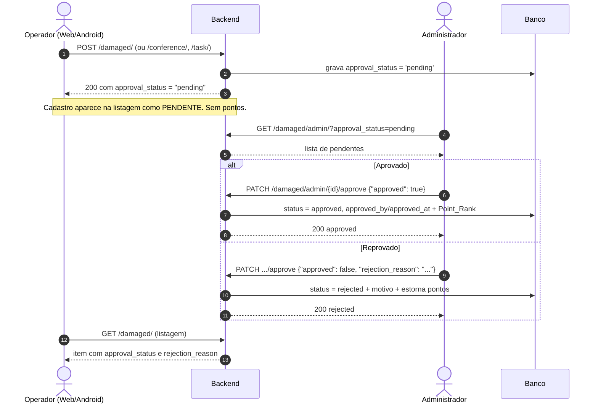

# README — Aprovação do Administrador (Avarias, Conferências e Tasks)

> **Módulos:** `/damaged`, `/conference`, `/task`
> **Arquivos principais:** `app/models/approval.py`, `app/models/damaged.py`, `app/models/conference.py`, `app/models/task.py`, `app/routers/damaged/admin_damaged.py`, `app/routers/conference/admin_conference.py`, `app/routers/task/admin_create_task.py`, `app/routers/approval_utils.py`
> **Público-alvo:** desenvolvedores Frontend (Web) e Android
> **Backend:** FastAPI + SQLModel (PostgreSQL)

---

## 1. Visão geral

Antes desta mudança, avarias, conferências e tasks eram cadastradas e **pontuavam imediatamente** (`Point_Rank`). Agora **todo cadastro destes três módulos nasce pendente** e só pontua depois que um administrador aprova.

Resumo do novo fluxo:

1. O operador cadastra (avaria, conferência ou responde/gera uma task).
2. O cadastro aparece nas listagens normais com `approval_status = "pending"`.
3. O administrador aprova (`approved`) ou reprova (`rejected`, com motivo obrigatório).
4. **Somente na aprovação** os pontos são creditados no ranking.
5. Se um cadastro aprovado for reprovado depois, os pontos são estornados.

> **Importante:** os pontos de task continuam dependendo também da conclusão da task. Ver [seção 7](#7-regras-de-pontuação).

---

## 2. O que mudou (para integração)

### 2.1 Campos novos nas respostas

Todos os três módulos agora devolvem:

| Campo | Tipo | Descrição |
| :--- | :--- | :--- |
| `approval_status` | `"pending"` \| `"approved"` \| `"rejected"` | Situação da aprovação. Novos cadastros = `pending`. |
| `rejection_reason` | `string \| null` | Motivo digitado pelo admin ao reprovar. `null` quando pendente/aprovado. |
| `approved_by` | `string \| null` | Nome do administrador que decidiu. |
| `approved_at` | `datetime \| null` (ISO 8601) | Momento da decisão. |

Avarias e conferências também passaram a devolver `user_id` (id do operador que cadastrou).

### 2.2 Novos endpoints administrativos

| Método | Endpoint | Perfil | Objetivo |
| :--- | :--- | :--- | :--- |
| `GET` | `/damaged/admin/?approval_status=&local=` | admin | Listar avarias com filtro de aprovação/filial. |
| `PATCH` | `/damaged/admin/{id}/approve` | admin | Aprovar ou reprovar uma avaria. |
| `GET` | `/conference/admin/?approval_status=&local=` | admin | Listar conferências com filtro de aprovação/filial. |
| `PATCH` | `/conference/admin/{id}/approve` | admin | Aprovar ou reprovar uma conferência. |
| `PATCH` | `/task/admin/tasks/{task_id}/approve` | admin | Aprovar ou reprovar uma task. |
| `GET` | `/task/admin/tasks/?approval_status=` | admin | A listagem admin existente ganhou o filtro `approval_status`. |

Todos exigem token JWT com a claim `admin` verdadeira. Usuário autenticado sem perfil admin recebe `403`.

### 2.3 O que **não** mudou

- Os endpoints de criação continuam iguais (`POST /damaged/`, `POST /conference/`, `POST /task/`); nenhum campo novo é enviado pelo operador.
- As listagens operacionais continuam retornando todos os registros — apenas com os campos de status adicionais.
- Rotas de metas semanais, recebimentos e ranking não foram alteradas.

---

## 3. Modelo da decisão

### 3.1 `ApprovalDecision` (body do PATCH)

```json
{
  "approved": true,
  "rejection_reason": null
}
```

| Campo | Tipo | Obrigatório | Regra |
| :--- | :--- | :---: | :--- |
| `approved` | `bool` | Não (padrão `true`) | `true` aprova, `false` reprova. |
| `rejection_reason` | `string` | **Sim quando `approved = false`** | Texto do motivo. Se vazio/ausente ao reprovar: `400 Motivo da reprovação é obrigatório`. |

Regras da decisão:

- Reprovar **estorna** os pontos já concedidos por aquele cadastro.
- Aprovar novamente um cadastro reprovado concede os pontos de volta (sujeito à regra anti-duplicidade de 5 dias por produto/filial).
- Toda decisão grava log de auditoria (`Aprovar Avaria`, `Reprovar Conferência`, `Aprovar Task`, etc.), incluindo o motivo quando houver.
- Task criada pelo admin (`POST /task/admin/` ou `/task/admin/custom/`) **já nasce aprovada**, porque o próprio admin é o aprovador.

---

## 4. Schemas de resposta

### 4.1 Avaria — `DamagedProductRead`

```json
{
  "id": 42,
  "product_code": "12414",
  "product_name": "PRODUTO EXEMPLO",
  "quantity": 2.0,
  "cost": 2.5,
  "cost_total": 5.0,
  "created_date": "2026-11-24",
  "shelflife_date": "2026-12-24",
  "damaged_date": "2026-11-24",
  "created_by": "Operador",
  "user_id": 7,
  "type": 1,
  "origin": 1,
  "local": 1,
  "approval_status": "pending",
  "rejection_reason": null,
  "approved_by": null,
  "approved_at": null
}
```

### 4.2 Conferência — `ConferenceRead`

```json
{
  "id": 15,
  "product_code": "12414",
  "product_name": "PRODUTO EXEMPLO",
  "quantity_system": 10.0,
  "quantity_real": 9.0,
  "diference": -1.0,
  "cost_total": -2.5,
  "date_": "2026-11-24",
  "local": 1,
  "created_date": "2026-11-24",
  "created_by": "Operador",
  "user_id": 7,
  "approval_status": "pending",
  "rejection_reason": null,
  "approved_by": null,
  "approved_at": null
}
```

### 4.3 Task — `TaskRead` / `AdminTaskRead`

```json
{
  "id": 8,
  "user_id": 7,
  "user_name": "Operador",
  "quantity": 3,
  "completed": true,
  "branch_code": 1,
  "created_date": "2026-11-24",
  "approval_status": "pending",
  "rejection_reason": null,
  "approved_by": null,
  "approved_at": null
}
```

`AdminTaskRead` (usado em `GET /task/admin/tasks/` e no PATCH de aprovação) adiciona:

| Campo | Tipo | Descrição |
| :--- | :--- | :--- |
| `items_confirmed` | `int` | Quantos itens já têm `quantity_real` preenchido. |

---

## 5. Endpoints em detalhe

### 5.1 `GET /damaged/admin/`

**Query params:**

| Parâmetro | Tipo | Obrigatório | Descrição |
| :--- | :--- | :---: | :--- |
| `approval_status` | `"pending"` \| `"approved"` \| `"rejected"` | Não | Filtra pela situação. Valor inválido → `400`. |
| `local` | `int` | Não | Filtra pela filial. |

**Exemplo:**

```bash
curl "http://localhost:8000/damaged/admin/?approval_status=pending&local=1" \
  -H "Authorization: Bearer <token_admin>"
```

**Resposta `200 OK`:** lista de `DamagedProductRead` (mais recentes primeiro).

---

### 5.2 `PATCH /damaged/admin/{id}/approve`

**Exemplo (aprovar):**

```bash
curl -X PATCH "http://localhost:8000/damaged/admin/42/approve" \
  -H "Authorization: Bearer <token_admin>" \
  -H "Content-Type: application/json" \
  -d '{"approved": true}'
```

**Exemplo (reprovar):**

```bash
curl -X PATCH "http://localhost:8000/damaged/admin/42/approve" \
  -H "Authorization: Bearer <token_admin>" \
  -H "Content-Type: application/json" \
  -d '{"approved": false, "rejection_reason": "Quantidade divergente da nota fiscal"}'
```

**Resposta `200 OK`:** `DamagedProductRead` atualizado.

**Erros:**

| Status | `detail` |
| :---: | :--- |
| `403` | `Apenas administradores podem aprovar avarias` |
| `404` | `Avaria não encontrada` |
| `400` | `Motivo da reprovação é obrigatório` |

---

### 5.3 `GET /conference/admin/`

Mesmos parâmetros de `/damaged/admin/` (`approval_status`, `local`). Retorna lista de `ConferenceRead`, mais recentes primeiro.

### 5.4 `PATCH /conference/admin/{id}/approve`

Mesmo contrato de body do endpoint de avaria.

**Erros:**

| Status | `detail` |
| :---: | :--- |
| `403` | `Apenas administradores podem aprovar conferências` |
| `404` | `Conferência não encontrada` |
| `400` | `Motivo da reprovação é obrigatório` |

---

### 5.5 `GET /task/admin/tasks/`

**Query params:**

| Parâmetro | Tipo | Descrição |
| :--- | :--- | :--- |
| `user_id` | `int` | Filtra tasks de um operador. |
| `completed` | `bool` | `true` concluídas / `false` pendentes de resposta. |
| `approval_status` | `"pending"` \| `"approved"` \| `"rejected"` | **Novo.** Filtra pela situação de aprovação. |

**Resposta `200 OK`:** lista de `AdminTaskRead`.

### 5.6 `PATCH /task/admin/tasks/{task_id}/approve`

```bash
curl -X PATCH "http://localhost:8000/task/admin/tasks/8/approve" \
  -H "Authorization: Bearer <token_admin>" \
  -H "Content-Type: application/json" \
  -d '{"approved": false, "rejection_reason": "Produto conferido na filial errada"}'
```

**Resposta `200 OK`:** `AdminTaskRead` atualizado (com `items_confirmed`).

**Erros:**

| Status | `detail` |
| :---: | :--- |
| `403` | `Only administrators can approve tasks` |
| `404` | `Task not found` |
| `400` | `Motivo da reprovação é obrigatório` |

---

## 6. Fluxo completo



---

## 7. Regras de pontuação

| Módulo | Ação no ranking | Pontos | Quando é creditado |
| :--- | :--- | :---: | :--- |
| Avaria | `Criar Avaria` | **5** | Aprovação da avaria. |
| Conferência | `Criar Conferência` | **2** | Aprovação da conferência. |
| Task (conclusão) | `Concluir Task` | **5** | Aprovação **e** task respondida. |
| Task (por produto) | `Conferir produto na task` | **3 por item** | Aprovação **e** task respondida. |

Detalhes importantes:

- **Nada pontua no cadastro.** O ranking só muda na aprovação.
- **Task:** aprovar uma task ainda não respondida não pontua na hora. Quando o operador responder (`PUT /task/items/`), os pontos são liberados se a task já estiver aprovada. Se o operador responder antes, os pontos são liberados no momento da aprovação.
- **Anti-duplicidade:** a regra existente continua valendo — mesmo produto + mesma filial dentro de 5 dias não pontua de novo. Uma aprovação pode, portanto, gerar **0 pontos** legitimamente; isso não é erro.
- **Reprovação estorna** os pontos do cadastro (`Point_Rank` com `action_id` do cadastro é removido).
- **Aprovar novamente** concede os pontos outra vez, respeitando a janela de 5 dias.

---

## 8. Tabela geral de erros

| Status | Quando ocorre | Exemplo de `detail` |
| :---: | :--- | :--- |
| `400` | Reprovar sem motivo. | `Motivo da reprovação é obrigatório` |
| `400` | Filtro `approval_status` inválido. | `Status de aprovação inválido` |
| `401` | Token ausente/expirado. | `Token inválido` |
| `403` | Usuário sem `admin = 1`. | `Apenas administradores podem aprovar avarias` |
| `404` | Cadastro inexistente. | `Avaria não encontrada` / `Conferência não encontrada` / `Task not found` |

---

## 9. Integração Frontend (TypeScript / fetch)

### 9.1 Tipos

```typescript
export type ApprovalStatus = "pending" | "approved" | "rejected";

export interface ApprovalInfo {
  approval_status: ApprovalStatus;
  rejection_reason: string | null;
  approved_by: string | null;
  approved_at: string | null; // ISO 8601
}

export interface Damaged extends ApprovalInfo {
  id: number;
  product_code: string;
  product_name: string;
  quantity: number;
  cost: number;
  cost_total: number;
  created_date: string;
  shelflife_date: string;
  damaged_date: string;
  created_by: string;
  user_id: number | null;
  type: number;
  origin: number;
  local: number;
}

export interface Conference extends ApprovalInfo {
  id: number;
  product_code: string;
  product_name: string;
  quantity_system: number;
  quantity_real: number;
  diference: number;
  cost_total: number;
  date_: string;
  local: number;
  created_date: string;
  created_by: string;
  user_id: number | null;
}

export interface TaskItem {
  id: number;
  user_id: number;
  user_name: string;
  quantity: number;
  completed: boolean;
  branch_code: number;
  created_date: string;
  approval_status: ApprovalStatus;
  rejection_reason: string | null;
  approved_by: string | null;
  approved_at: string | null;
  items_confirmed?: number; // somente nas rotas admin
}

export interface ApprovalDecision {
  approved: boolean;
  rejection_reason?: string | null;
}
```

### 9.2 Funções de API

```typescript
const API_URL = "http://localhost:8000";
const auth = (token: string) => ({ Authorization: `Bearer ${token}` });

async function parse<T>(response: Response): Promise<T> {
  if (!response.ok) {
    const error = await response.json().catch(() => ({}));
    throw new Error(error.detail || "Erro na requisição");
  }
  return response.json();
}

// --- Avarias ---
export async function listPendingDamaged(token: string, local?: number) {
  const params = new URLSearchParams({ approval_status: "pending" });
  if (local) params.append("local", String(local));
  return parse<Damaged[]>(
    await fetch(`${API_URL}/damaged/admin/?${params}`, { headers: auth(token) })
  );
}

export async function decideDamaged(
  token: string,
  id: number,
  decision: ApprovalDecision
) {
  return parse<Damaged>(
    await fetch(`${API_URL}/damaged/admin/${id}/approve`, {
      method: "PATCH",
      headers: { ...auth(token), "Content-Type": "application/json" },
      body: JSON.stringify(decision),
    })
  );
}

// --- Conferências ---
export async function listPendingConferences(token: string, local?: number) {
  const params = new URLSearchParams({ approval_status: "pending" });
  if (local) params.append("local", String(local));
  return parse<Conference[]>(
    await fetch(`${API_URL}/conference/admin/?${params}`, { headers: auth(token) })
  );
}

export async function decideConference(
  token: string,
  id: number,
  decision: ApprovalDecision
) {
  return parse<Conference>(
    await fetch(`${API_URL}/conference/admin/${id}/approve`, {
      method: "PATCH",
      headers: { ...auth(token), "Content-Type": "application/json" },
      body: JSON.stringify(decision),
    })
  );
}

// --- Tasks ---
export async function listPendingTasks(token: string) {
  return parse<TaskItem[]>(
    await fetch(`${API_URL}/task/admin/tasks/?approval_status=pending`, {
      headers: auth(token),
    })
  );
}

export async function decideTask(
  token: string,
  taskId: number,
  decision: ApprovalDecision
) {
  return parse<TaskItem>(
    await fetch(`${API_URL}/task/admin/tasks/${taskId}/approve`, {
      method: "PATCH",
      headers: { ...auth(token), "Content-Type": "application/json" },
      body: JSON.stringify(decision),
    })
  );
}
```

### 9.3 Componentes sugeridos

- **Badge de status** nas listagens e detalhes:

| `approval_status` | Rótulo | Cor sugerida |
| :--- | :--- | :--- |
| `pending` | Pendente | amarelo/âmbar |
| `approved` | Aprovado | verde |
| `rejected` | Reprovado | vermelho |

- **Modal de reprovação** com textarea obrigatório (botão confirmar desabilitado com motivo vazio), enviando `{ approved: false, rejection_reason }`.
- **Somente admin** vê os botões Aprovar/Reprovar (`user.admin` da claim do token).
- No card do operador, exibir `rejection_reason` quando `approval_status === "rejected"`.
- As listagens do operador (`GET /damaged/`, `/conference/`, `/task/`) **já retornam** todos os cadastros; basta renderizar o badge e não esconder pendentes.

---

## 10. Integração Android (Kotlin / Retrofit)

### 10.1 Data classes

```kotlin
enum class ApprovalStatus {
    @SerializedName("pending") PENDING,
    @SerializedName("approved") APPROVED,
    @SerializedName("rejected") REJECTED,
}

data class ApprovalDecision(
    val approved: Boolean,
    @SerializedName("rejection_reason") val rejectionReason: String? = null
)

data class Damaged(
    val id: Int,
    @SerializedName("product_code") val productCode: String,
    @SerializedName("product_name") val productName: String,
    val quantity: Double,
    val cost: Double,
    @SerializedName("cost_total") val costTotal: Double,
    @SerializedName("created_date") val createdDate: String,
    @SerializedName("shelflife_date") val shelflifeDate: String,
    @SerializedName("damaged_date") val damagedDate: String,
    @SerializedName("created_by") val createdBy: String,
    @SerializedName("user_id") val userId: Int? = null,
    val type: Int,
    val origin: Int,
    val local: Int,
    @SerializedName("approval_status") val approvalStatus: ApprovalStatus,
    @SerializedName("rejection_reason") val rejectionReason: String? = null,
    @SerializedName("approved_by") val approvedBy: String? = null,
    @SerializedName("approved_at") val approvedAt: String? = null
)

data class Conference(
    val id: Int,
    @SerializedName("product_code") val productCode: String,
    @SerializedName("product_name") val productName: String,
    @SerializedName("quantity_system") val quantitySystem: Double,
    @SerializedName("quantity_real") val quantityReal: Double,
    val diference: Double,
    @SerializedName("cost_total") val costTotal: Double,
    @SerializedName("date_") val date: String,
    val local: Int,
    @SerializedName("created_date") val createdDate: String,
    @SerializedName("created_by") val createdBy: String,
    @SerializedName("user_id") val userId: Int? = null,
    @SerializedName("approval_status") val approvalStatus: ApprovalStatus,
    @SerializedName("rejection_reason") val rejectionReason: String? = null,
    @SerializedName("approved_by") val approvedBy: String? = null,
    @SerializedName("approved_at") val approvedAt: String? = null
)

data class TaskSummary(
    val id: Int,
    @SerializedName("user_id") val userId: Int,
    @SerializedName("user_name") val userName: String,
    val quantity: Int,
    val completed: Boolean,
    @SerializedName("branch_code") val branchCode: Int,
    @SerializedName("created_date") val createdDate: String,
    @SerializedName("approval_status") val approvalStatus: ApprovalStatus,
    @SerializedName("rejection_reason") val rejectionReason: String? = null,
    @SerializedName("approved_by") val approvedBy: String? = null,
    @SerializedName("approved_at") val approvedAt: String? = null,
    @SerializedName("items_confirmed") val itemsConfirmed: Int = 0
)
```

### 10.2 Interface Retrofit

```kotlin
interface ApprovalApiService {

    // Avarias
    @GET("damaged/admin/")
    suspend fun listPendingDamaged(
        @Query("approval_status") status: String = "pending",
        @Query("local") local: Int? = null
    ): Response<List<Damaged>>

    @PATCH("damaged/admin/{id}/approve")
    suspend fun decideDamaged(
        @Path("id") id: Int,
        @Body decision: ApprovalDecision
    ): Response<Damaged>

    // Conferências
    @GET("conference/admin/")
    suspend fun listPendingConferences(
        @Query("approval_status") status: String = "pending",
        @Query("local") local: Int? = null
    ): Response<List<Conference>>

    @PATCH("conference/admin/{id}/approve")
    suspend fun decideConference(
        @Path("id") id: Int,
        @Body decision: ApprovalDecision
    ): Response<Conference>

    // Tasks
    @GET("task/admin/tasks/")
    suspend fun listPendingTasks(
        @Query("approval_status") status: String = "pending",
        @Query("user_id") userId: Int? = null,
        @Query("completed") completed: Boolean? = null
    ): Response<List<TaskSummary>>

    @PATCH("task/admin/tasks/{id}/approve")
    suspend fun decideTask(
        @Path("id") taskId: Int,
        @Body decision: ApprovalDecision
    ): Response<TaskSummary>
}
```

### 10.3 Boas práticas no app

1. **Enum tolerante:** use `@SerializedName` e mantenha um fallback para valores desconhecidos (`PENDING`) para evitar crash em versões antigas do app.
2. **Reprovação:** valide no app que `rejectionReason` não está em branco antes de habilitar o envio; o backend também recusa com `400`.
3. **Controle de acesso:** só exiba o fluxo de aprovação quando `admin == 1` na claim do token; ainda assim trate `403` como sessão sem permissão.
4. **Listagens do operador:** continuam vindo completas. Mostre o badge de status e o motivo da reprovação no detalhe.
5. **Pontos:** não atualize o ranking local após o cadastro. Atualize após a aprovação (ou ao abrir a tela de ranking).
6. **Reenvio da decisão:** os endpoints de aprovação são idempotentes para o mesmo cadastro; repetir a chamada não duplica pontos.

---

## 11. Compatibilidade e migração

- Colunas novas: `approval_status`, `rejection_reason`, `approved_by`, `approved_at` nas tabelas `damagedproduct`, `conference` e `task`; `user_id` em `damagedproduct` e `conference`.
- A API aplica a migração automaticamente na inicialização (`app/database/migrations.py`, chamado em `main.py`) de forma idempotente.
- Para rodar manualmente no PostgreSQL: `sql/migration_approval_damaged_conference_task.sql`.
- **Registros antigos** recebem `approval_status = 'approved'`, pois foram criados antes da exigência de aprovação — não perdem pontos nem somem das listagens.
- Todos os campos novos são aditivos: clientes que ainda não os conhecem continuam funcionando (apenas não exibem o status).
- Campos novos podem vir `null` (`rejection_reason`, `approved_by`, `approved_at`) — trate como nulos no front e no app.

---

## 12. Checklist de implementação

### Frontend Web
- [ ] Adicionar `approval_status`, `rejection_reason`, `approved_by`, `approved_at` aos tipos/interfaces.
- [ ] Exibir badge de status nas listagens de avarias, conferências e tasks.
- [ ] Criar telas/abas administrativas de pendentes usando os endpoints `/admin/`.
- [ ] Implementar modal de reprovação com motivo obrigatório.
- [ ] Exibir motivo da reprovação para o operador no detalhe do cadastro.
- [ ] Esconder ações administrativas para `admin = 0`.
- [ ] Atualizar o ranking após aprovação (os pontos não aparecem mais no cadastro).

### Android
- [ ] Adicionar campos e o enum `ApprovalStatus` nas data classes.
- [ ] Criar chamadas Retrofit para os quatro endpoints de decisão/listagem.
- [ ] Validar motivo obrigatório na reprovação.
- [ ] Exibir badge e motivo da reprovação.
- [ ] Restringir o fluxo de aprovação a usuários admin.
- [ ] Tratar `403`, `404` e `400` com mensagens claras.

---

## 13. Exemplos rápidos (cURL)

```bash
BASE="http://localhost:8000"
TOKEN="<token_de_um_admin>"

# Pendentes
curl "$BASE/damaged/admin/?approval_status=pending" -H "Authorization: Bearer $TOKEN"
curl "$BASE/conference/admin/?approval_status=pending" -H "Authorization: Bearer $TOKEN"
curl "$BASE/task/admin/tasks/?approval_status=pending" -H "Authorization: Bearer $TOKEN"

# Aprovar
curl -X PATCH "$BASE/damaged/admin/42/approve" \
  -H "Authorization: Bearer $TOKEN" -H "Content-Type: application/json" \
  -d '{"approved": true}'

# Reprovar (motivo obrigatório)
curl -X PATCH "$BASE/conference/admin/15/approve" \
  -H "Authorization: Bearer $TOKEN" -H "Content-Type: application/json" \
  -d '{"approved": false, "rejection_reason": "Divergência não justificada"}'

# Task
curl -X PATCH "$BASE/task/admin/tasks/8/approve" \
  -H "Authorization: Bearer $TOKEN" -H "Content-Type: application/json" \
  -d '{"approved": true}'
```

---

## 14. Observações finais

- As rotas de **metas semanais** e de **geração de tasks** não foram alteradas nesta entrega; elas continuam considerando os registros existentes como antes.
- O ranking (`GET /rank/`) só reflete os pontos depois da aprovação.
- Para auditoria, consulte `GET /logs/`: cada decisão registra a ação `Aprovar ...` / `Reprovar ...`, o administrador responsável e o motivo quando houver.
- Em caso de dúvida sobre o fluxo operacional de cada módulo, consulte também `API_DOCUMENTATION.md`, `TASK_DOCUMENTATION.md` e `README_RECEIPT.md`.
