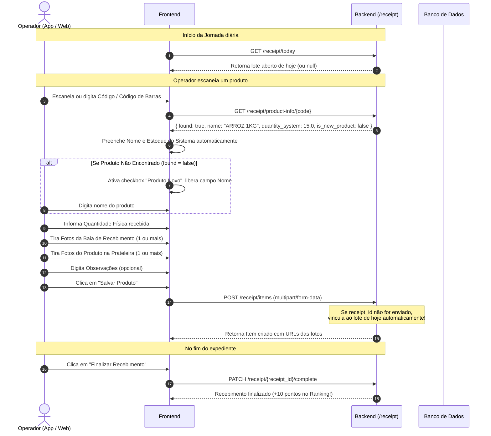

# Guia Completo e Documentação da Rota de Recebimento (`/receipt`)

> **Módulo:** Recebimento de Mercadorias (V2 - Multi-Produtos e Múltiplas Fotos)  
> **Backend:** FastAPI + SQLModel (PostgreSQL)  
> **Público-alvo:** Desenvolvedores Frontend (Web e Mobile/Android) e DevOps  
> **Rota administrativa:** consulte `README_ADMIN_RECEIPT.md` para os endpoints `/receipt/admin/*` (KPIs, aprovação, finalização forçada, exclusão e produtos novos).  
> **Frontend Web:** a implementação da página operacional está documentada na seção 8 deste arquivo.

---

## 1. Visão Geral da Nova Arquitetura

O módulo de **Recebimento de Mercadorias** foi reformulado para refletir a rotina operacional real dos centros de distribuição e estoques:

1. **Lote / Sessão Diária de Recebimento (`Receipt`):**
   - Um recebimento representa o conjunto de produtos recebidos na filial ao longo do dia.
   - Pode ser aberto explicitamente ou iniciado automaticamente ao registrar o primeiro produto.
   - Permanece em andamento (`completed = false`) enquanto a equipe recebe produtos.
   - Ao final da rotina, é finalizado (`completed = true`), bloqueando alterações e concedendo **+10 pontos** no Ranking para o operador.

2. **Produtos Recebidos (`ReceiptItem`):**
   - Cada produto recebido é vinculado ao lote do dia.
   - Suporta **produtos já cadastrados** no sistema e **produtos novos** (ainda não cadastrados).
   - Registra automaticamente o usuário que recebeu e o timestamp exato do recebimento.
   - Calcula a diferença entre a contagem física e o estoque do sistema.

3. **Múltiplas Fotos por Requisito (`ReceiptItemPhoto`):**
   - **Fotos na baia de recebimento (`dock` / `baia`):** 1 ou mais fotos do produto descarregado na doca.
   - **Fotos na prateleira (`shelf` / `prateleira`):** 1 ou mais fotos do produto alocado em seu endereço de prateleira/gôndola.
   - Armazenadas com segurança no storage local `/uploads/receipts/items/{item_id}/` e servidas estaticamente.

---

## 2. Modelagem de Dados

### 2.1 Tabela `receipt` (Cabeçalho da Sessão do Dia)
| Campo | Tipo | Descrição |
| :--- | :--- | :--- |
| `id` | `INTEGER PRIMARY KEY` | Identificador único do lote de recebimento. |
| `user_id` | `INTEGER` (FK `user.id`) | ID do usuário que abriu o recebimento. |
| `user_name` | `VARCHAR` | Nome do usuário que abriu o recebimento. |
| `local` | `INTEGER` | ID da Filial/Loja onde ocorre o recebimento. |
| `created_date` | `DATE` | Data do recebimento (padrão: data atual UTC). |
| `time_stamp` | `TIMESTAMP` | Horário de abertura. |
| `completed` | `BOOLEAN` | `false` = Em andamento / `true` = Finalizado. |
| `completed_at`| `TIMESTAMP` (opcional) | Data e hora exatas da finalização. |
| `quantity` | `INTEGER` | Quantidade total de itens cadastrados no lote. |
| `observations`| `VARCHAR` (opcional) | Observações gerais do lote. |
| `photo` | `VARCHAR` (opcional) | Foto geral da nota/carga (legado). |

### 2.2 Tabela `receipt_item` (Produto Recebido)
| Campo | Tipo | Descrição |
| :--- | :--- | :--- |
| `id` | `INTEGER PRIMARY KEY` | Identificador único do item recebido. |
| `receipt_id` | `INTEGER` (FK `receipt.id`) | ID do lote de recebimento pai. |
| `product_code` | `VARCHAR(50)` (opcional) | Código do produto no sistema (ou código de barras de fábrica). |
| `is_new_product`| `BOOLEAN` | `true` se for produto novo ainda não cadastrado. |
| `product_name` | `VARCHAR(255)` | Nome do produto (obtido do cadastro ou digitado se novo). |
| `quantity_system`| `DOUBLE PRECISION` | Quantidade em estoque no sistema na filial no momento do recebimento (0 se novo). |
| `quantity_physical`| `DOUBLE PRECISION` | Quantidade conferida e recebida fisicamente. |
| `difference` | `DOUBLE PRECISION` | Diferença calculada (`quantity_physical - quantity_system`). |
| `received_quantity`| `DOUBLE PRECISION` | Quantidade efetivamente recebida (default: igual à quantidade física). |
| `invoice_photo` | `VARCHAR(500)` (opcional) | URL da foto da nota fiscal do produto (`/uploads/receipts/items/{id}/invoice_*.jpg`). |
| `user_id` | `INTEGER` (FK `user.id`) | **Automático**: ID do usuário logado que recebeu o produto. |
| `user_name` | `VARCHAR` | **Automático**: Nome do usuário que recebeu. |
| `received_at` | `TIMESTAMP` | **Automático**: Data e horário exatos em que o produto foi registrado. |
| `observations` | `VARCHAR` (opcional) | Observações sobre o produto, estado da embalagem, etc. |

### 2.3 Tabela `receipt_item_photo` (Fotos do Item)
| Campo | Tipo | Descrição |
| :--- | :--- | :--- |
| `id` | `INTEGER PRIMARY KEY` | ID único da foto. |
| `receipt_item_id`| `INTEGER` (FK `receipt_item.id`) | ID do produto recebido a que a foto pertence. |
| `photo_type` | `VARCHAR(20)` | Tipo da foto: `'dock'` (baia) ou `'shelf'` (prateleira). |
| `filename` | `VARCHAR(255)` | Nome do arquivo gerado em disco com UUID. |
| `filepath` | `VARCHAR(500)` | Caminho absoluto do arquivo no servidor. |
| `url` | `VARCHAR(500)` | URL relativa para exibição no frontend (`/uploads/receipts/items/{id}/{file}`). |
| `created_at` | `TIMESTAMP` | Data e hora do upload da imagem. |

---

## 3. Implantação e Migração do Banco de Dados

### 3.1 Script de Migração SQL
Caso o banco já possua a tabela `receipt` antiga, execute o script localizado em `sql/migration_receipt_v2.sql`:

> **Atualização (Foto da Nota Fiscal + Quantidade Recebida):** para bancos que já rodaram a migração V2, execute também `sql/migration_receipt_invoice_quantity.sql`, que adiciona as colunas `received_quantity` e `invoice_photo` em `receipt_item`.

```sql
BEGIN;

-- 1. Novas colunas na tabela receipt
ALTER TABLE receipt ADD COLUMN IF NOT EXISTS observations VARCHAR;
ALTER TABLE receipt ADD COLUMN IF NOT EXISTS completed_at TIMESTAMP WITHOUT TIME ZONE;

-- 2. Tabela de itens do recebimento
CREATE TABLE IF NOT EXISTS receipt_item (
    id SERIAL PRIMARY KEY,
    receipt_id INTEGER NOT NULL REFERENCES receipt(id) ON DELETE CASCADE,
    product_code VARCHAR(50),
    is_new_product BOOLEAN NOT NULL DEFAULT FALSE,
    product_name VARCHAR(255) NOT NULL,
    quantity_system DOUBLE PRECISION NOT NULL DEFAULT 0.0,
    quantity_physical DOUBLE PRECISION NOT NULL DEFAULT 0.0,
    difference DOUBLE PRECISION DEFAULT 0.0,
    user_id INTEGER NOT NULL REFERENCES "user"(id),
    user_name VARCHAR NOT NULL,
    received_at TIMESTAMP WITHOUT TIME ZONE NOT NULL DEFAULT NOW(),
    observations VARCHAR
);

CREATE INDEX IF NOT EXISTS ix_receipt_item_receipt_id ON receipt_item (receipt_id);
CREATE INDEX IF NOT EXISTS ix_receipt_item_product_code ON receipt_item (product_code);

-- 3. Tabela de fotos dos itens
CREATE TABLE IF NOT EXISTS receipt_item_photo (
    id SERIAL PRIMARY KEY,
    receipt_item_id INTEGER NOT NULL REFERENCES receipt_item(id) ON DELETE CASCADE,
    photo_type VARCHAR(20) NOT NULL,
    filename VARCHAR(255) NOT NULL,
    filepath VARCHAR(500) NOT NULL,
    url VARCHAR(500) NOT NULL,
    created_at TIMESTAMP WITHOUT TIME ZONE NOT NULL DEFAULT NOW()
);

CREATE INDEX IF NOT EXISTS ix_receipt_item_photo_receipt_item_id ON receipt_item_photo (receipt_item_id);

COMMIT;
```

> **Nota:** Ao iniciar a aplicação FastAPI, o comando `SQLModel.metadata.create_all(engine)` cria automaticamente as tabelas caso ainda não existam.

### 3.2 Diretórios de Armazenamento
O backend cria automaticamente em tempo de execução:
- `uploads/receipts/`
- `uploads/receipts/items/`

---

## 4. Guia de Integração para o Frontend

### 4.1 Autenticação
Todas as requisições exigem o cabeçalho HTTP:
```http
Authorization: Bearer <token_jwt>
```
O token é obtido em `POST /auth/login`. O backend extrai `user_id`, `user_name` e `local` diretamente do token.

---

### 4.2 Fluxo Operacional Recomendado (Passo a Passo na Interface)



---

## 5. Catálogo Detalhado de Endpoints

### 5.1 `GET /receipt/product-info/{code}`
**Objetivo:** Auto-completar o formulário quando o operador digita ou lê o código/código de barras.

- **Método:** `GET`
- **Query Params:**
  - `local` *(int, opcional)*: Filial para consulta de estoque (padrão: filial do usuário logado).
- **Exemplo de Resposta — Produto Encontrado:**
  ```json
  {
    "found": true,
    "code": "10628",
    "external_id": 10628,
    "name": "BARRA CEREAL BRIGADEIRO TRIO CX 24 PCT 3 UN 20 G",
    "price": 2.76,
    "quantity_system": 12.0,
    "is_new_product": false,
    "barcodes": ["10628", "7897900312592"]
  }
  ```
- **Exemplo de Resposta — Produto Novo / Não Encontrado:**
  ```json
  {
    "found": false,
    "code": "789999999999",
    "external_id": null,
    "name": "",
    "price": null,
    "quantity_system": 0.0,
    "is_new_product": true,
    "barcodes": []
  }
  ```

---

### 5.2 `POST /receipt/items` (ou `POST /receipt/{receipt_id}/items`)
**Objetivo:** Enviar o formulário de recebimento de um produto com suas respectivas fotos da baia e da prateleira.

- **Método:** `POST`
- **Content-Type:** `multipart/form-data`
- **Campos do Formulário:**

| Campo | Tipo | Obrigatório? | Descrição |
| :--- | :--- | :---: | :--- |
| `receipt_id` | `int` | Não | ID do lote. Se omitido, **vincula automaticamente ao lote aberto de hoje** na filial do usuário. |
| `product_code` | `string` | Condicional | Obrigatório se produto cadastrado. Opcional para produto novo. |
| `is_new_product` | `bool` | Não (default `false`) | Envie `true` caso seja um produto não cadastrado no sistema. |
| `product_name` | `string` | Condicional | Obrigatório se `is_new_product=true`. Se `false`, o backend busca o nome cadastrado. |
| `quantity_physical`| `float` | **Sim** | Quantidade física contada e recebida. |
| `quantity_system` | `float` | Não | Se omitido e cadastrado, o backend obtém do estoque da filial. Se novo, default 0. |
| `received_quantity`| `float` | Não | Quantidade efetivamente recebida. Se omitida, assume o valor de `quantity_physical`. |
| `invoice_photo` | `file` | Não | **Foto da Nota Fiscal do Produto** (1 imagem: jpg, jpeg, png ou webp). |
| `observations` | `string` | Não | Observações opcionais. |
| `dock_photos` | `file[]` | Não | **Fotos na Baia de Recebimento** (1 ou mais). Aceita também chave `baia_photos`. |
| `shelf_photos` | `file[]` | Não | **Fotos na Prateleira** (1 ou mais). Aceita também chave `prateleira_photos`. |

- **Exemplo de Resposta (`200 OK`):**
  ```json
  {
    "id": 15,
    "receipt_id": 42,
    "product_code": "10628",
    "is_new_product": false,
    "product_name": "BARRA CEREAL BRIGADEIRO TRIO CX 24 PCT 3 UN 20 G",
    "quantity_system": 12.0,
    "quantity_physical": 24.0,
    "difference": 12.0,
    "received_quantity": 24.0,
    "invoice_photo": "/uploads/receipts/items/15/invoice_a9b8c7d6e5f4.jpg",
    "user_id": 3,
    "user_name": "Carlos Silva",
    "received_at": "2026-10-24T10:30:00Z",
    "observations": "Caixas íntegras e lacradas",
    "dock_photos": [
      {
        "id": 101,
        "photo_type": "dock",
        "filename": "dock_a1b2c3d4e5f6.jpg",
        "url": "/uploads/receipts/items/15/dock_a1b2c3d4e5f6.jpg",
        "created_at": "2026-10-24T10:30:02Z"
      }
    ],
    "shelf_photos": [
      {
        "id": 102,
        "photo_type": "shelf",
        "filename": "shelf_f6e5d4c3b2a1.jpg",
        "url": "/uploads/receipts/items/15/shelf_f6e5d4c3b2a1.jpg",
        "created_at": "2026-10-24T10:30:04Z"
      }
    ]
  }
  ```

---

### 5.3 `GET /receipt/today` (ou `/receipt/active`)
**Objetivo:** Retorna o recebimento em andamento de hoje na filial do usuário logado com todos os itens já recebidos.

- **Método:** `GET`
- **Query Params:** `local` *(int, opcional)*
- **Resposta quando há recebimento em andamento:** Objeto completo do recebimento (`ReceiptRead`).
- **Resposta quando não há recebimento hoje:** `null` com status `200 OK`.

---

### 5.4 `GET /receipt/{receipt_id}` (ou `/receipt/id/{receipt_id}`)
**Objetivo:** Retorna um recebimento específico com a lista de todos os seus produtos recebidos e todas as fotos.

- **Método:** `GET`
- **Exemplo de Resposta (`200 OK`):**
  ```json
  {
    "id": 42,
    "user_id": 3,
    "user_name": "Carlos Silva",
    "quantity": 2,
    "local": 1,
    "created_date": "2026-10-24",
    "time_stamp": "2026-10-24T08:15:00Z",
    "completed": false,
    "completed_at": null,
    "approved": false,
    "photo": null,
    "observations": "Recebimento matutino",
    "items_count": 2,
    "total_physical_quantity": 74.0,
    "items": [
      {
        "id": 15,
        "receipt_id": 42,
        "product_code": "10628",
        "is_new_product": false,
        "product_name": "BARRA CEREAL BRIGADEIRO TRIO CX 24 PCT 3 UN 20 G",
        "quantity_system": 12.0,
        "quantity_physical": 24.0,
        "difference": 12.0,
        "received_quantity": 24.0,
        "invoice_photo": "/uploads/receipts/items/15/invoice_a9b8c7d6e5f4.jpg",
        "user_id": 3,
        "user_name": "Carlos Silva",
        "received_at": "2026-10-24T10:30:00Z",
        "observations": "Caixas íntegras",
        "dock_photos": [ ... ],
        "shelf_photos": [ ... ]
      },
      {
        "id": 16,
        "receipt_id": 42,
        "product_code": "7891234567890",
        "is_new_product": true,
        "product_name": "NOVO BISCOITO ARTESANAL 200G",
        "quantity_system": 0.0,
        "quantity_physical": 50.0,
        "difference": 50.0,
        "received_quantity": 50.0,
        "invoice_photo": null,
        "user_id": 3,
        "user_name": "Carlos Silva",
        "received_at": "2026-10-24T11:00:00Z",
        "observations": "Produto novo - aguardando cadastro no ERP",
        "dock_photos": [ ... ],
        "shelf_photos": [ ... ]
      }
    ]
  }
  ```

---

### 5.5 `GET /receipt/`
**Objetivo:** Listagem paginada e filtrável de todos os recebimentos.

- **Método:** `GET`
- **Query Params:**
  - `local` *(int)*: Filtrar por filial.
  - `date` *(date)*: Filtrar por data específica (`YYYY-MM-DD`).
  - `start_date` *(date)* / `end_date` *(date)*: Intervalo de datas.
  - `completed` *(bool)*: `true` para finalizados, `false` para abertos.
  - `limit` *(int, default 100)*, `offset` *(int, default 0)*.

---

### 5.6 `PATCH /receipt/{receipt_id}/complete` (ou `PATCH /receipt/{receipt_id}`)
**Objetivo:** Finaliza o lote de recebimento e atribui **+10 pontos** no Ranking para o operador.

- **Método:** `PATCH`
- **Regras:**
  - Requer ao menos 1 produto no recebimento.
  - Se já estiver finalizado, retorna `400 Bad Request`.
  - Registra log de auditoria `Finalizar`.
  - Atribui pontuação no `point_rank` (respeitando regra diária `days=0`).

---

### 5.7 `PATCH /receipt/{receipt_id}/reopen`
**Objetivo:** Reabre um recebimento previamente finalizado para ajustes operacionais.

- **Método:** `PATCH`

---

### 5.8 `PATCH /receipt/items/{item_id}`
**Objetivo:** Atualizar dados de um produto já recebido (ajustar contagem física, nome, observações, etc.).

- **Método:** `PATCH`
- **Content-Type:** `application/json`
- **Body:**
  ```json
  {
    "quantity_physical": 25.0,
    "observations": "Conferido novamente, havia 1 unidade a mais."
  }
  ```

---

### 5.9 `POST /receipt/items/{item_id}/photos`
**Objetivo:** Enviar fotos adicionais para um item já recebido.

- **Método:** `POST`
- **Content-Type:** `multipart/form-data`
- **Campos:**
  - `photo_type`: `"dock"` (baia) ou `"shelf"` (prateleira).
  - `photos`: Arquivos de imagem (`File[]`).

---

### 5.9.1 `POST /receipt/items/{item_id}/invoice-photo`
**Objetivo:** Enviar ou substituir a foto da nota fiscal de um item já recebido.

- **Método:** `POST`
- **Content-Type:** `multipart/form-data`
- **Campos:**
  - `invoice_photo`: Arquivo de imagem da nota fiscal (`jpg`, `jpeg`, `png` ou `webp`).
- **Resposta:** Item atualizado (`ReceiptItemRead`) com a URL em `invoice_photo`.

---

### 5.10 `DELETE /receipt/items/{item_id}/photos/{photo_id}`
**Objetivo:** Deleta uma foto específica do item e remove o arquivo do disco.

- **Método:** `DELETE`

---

### 5.11 `DELETE /receipt/items/{item_id}`
**Objetivo:** Remove um produto recebido, deleta todas as suas fotos em disco e atualiza a contagem do lote.

- **Método:** `DELETE`

---

### 5.12 `DELETE /receipt/{receipt_id}`
**Objetivo:** Remove o lote completo, todos os produtos, todas as fotos e cancela os pontos concedidos no Ranking.

- **Método:** `DELETE`

---

## 6. Exemplos de Implementação no Frontend

### 6.1 JavaScript / TypeScript (Web / React / Vue)

```typescript
// 1. Buscar dados do produto ao digitar ou ler código
async function searchProductForReceipt(code: string, token: string) {
  const response = await fetch(`/receipt/product-info/${encodeURIComponent(code)}`, {
    headers: { Authorization: `Bearer ${token}` }
  });
  return await response.json();
}

// 2. Enviar Formulário de Recebimento com Fotos
async function submitReceiptItem({
  receiptId,
  productCode,
  isNewProduct,
  productName,
  quantityPhysical,
  quantitySystem,
  observations,
  dockPhotos,   // File[]
  shelfPhotos,  // File[]
  token
}: {
  receiptId?: number;
  productCode?: string;
  isNewProduct: boolean;
  productName?: string;
  quantityPhysical: number;
  quantitySystem?: number;
  observations?: string;
  dockPhotos: File[];
  shelfPhotos: File[];
  token: string;
}) {
  const formData = new FormData();

  if (receiptId) formData.append("receipt_id", String(receiptId));
  if (productCode) formData.append("product_code", productCode);
  formData.append("is_new_product", String(isNewProduct));
  if (productName) formData.append("product_name", productName);
  formData.append("quantity_physical", String(quantityPhysical));
  if (quantitySystem !== undefined) formData.append("quantity_system", String(quantitySystem));
  if (observations) formData.append("observations", observations);

  // Múltiplas fotos na baia
  dockPhotos.forEach(file => formData.append("dock_photos", file));

  // Múltiplas fotos na prateleira
  shelfPhotos.forEach(file => formData.append("shelf_photos", file));

  const response = await fetch("/receipt/items", {
    method: "POST",
    headers: { Authorization: `Bearer ${token}` },
    body: formData
  });

  if (!response.ok) {
    const errorData = await response.json();
    throw new Error(errorData.detail || "Erro ao salvar item de recebimento");
  }

  return await response.json();
}

// 3. Finalizar Recebimento do Dia
async function completeReceipt(receiptId: number, token: string) {
  const response = await fetch(`/receipt/${receiptId}/complete`, {
    method: "PATCH",
    headers: { Authorization: `Bearer ${token}` }
  });
  return await response.json();
}
```

---

### 6.2 Kotlin / Android (Retrofit / OkHttp)

```kotlin
// Interface Retrofit
interface ReceiptApiService {

    @GET("receipt/product-info/{code}")
    suspend fun getProductInfo(
        @Path("code") code: String,
        @Query("local") local: Int? = null
    ): Response<ProductInfoResponse>

    @GET("receipt/today")
    suspend fun getTodayReceipt(
        @Query("local") local: Int? = null
    ): Response<ReceiptRead?>

    @Multipart
    @POST("receipt/items")
    suspend fun addReceiptItem(
        @Part("receipt_id") receiptId: RequestBody?,
        @Part("product_code") productCode: RequestBody?,
        @Part("is_new_product") isNewProduct: RequestBody,
        @Part("product_name") productName: RequestBody?,
        @Part("quantity_physical") quantityPhysical: RequestBody,
        @Part("quantity_system") quantitySystem: RequestBody?,
        @Part("observations") observations: RequestBody?,
        @Part dockPhotos: List<MultipartBody.Part>,
        @Part shelfPhotos: List<MultipartBody.Part>
    ): Response<ReceiptItemRead>

    @PATCH("receipt/{id}/complete")
    suspend fun completeReceipt(
        @Path("id") receiptId: Int
    ): Response<ReceiptRead>
}
```

---

## 7. Resumo dos Campos e Regras de Validação

1. **Produto Existente (`is_new_product = false`):**
   - O campo `product_code` é obrigatório.
   - O backend valida a existência do produto em `Productv2` ou pelo código de barras `ProductBarcode`.
   - Se o produto não for encontrado, a API responde `404 Not Found` informando para marcar a opção de produto novo caso seja um item sem cadastro.
   - O estoque do sistema (`quantity_system`) é obtido automaticamente da filial se não for enviado pelo cliente.

2. **Produto Novo (`is_new_product = true`):**
   - O campo `product_name` é obrigatório.
   - O campo `product_code` pode ser preenchido com o código de barras da embalagem ou deixado em branco (o sistema preenche como `"NOVO"`).
   - O estoque do sistema é definido como `0.0`.

3. **Múltiplas Fotos:**
   - O backend aceita 0, 1 ou várias fotos tanto para a baia quanto para a prateleira.
   - Extensões permitidas: `.jpg`, `.jpeg`, `.png`, `.webp`.
   - Cada foto salva recebe UUID próprio e URL direta servida em `/uploads/receipts/items/{item_id}/{filename}`.

4. **Usuário e Horário:**
   - Preenchidos 100% de forma automática pelo servidor (`user_id`, `user_name`, `received_at`), garantindo integridade e conformidade de auditoria.

---

## 8. Frontend Web — Página Operacional (`/recebimento`)

> **Arquivos:** `src/pages/recebimento/index.tsx`, `src/pages/recebimento/types.ts`, `src/pages/recebimento/photoGallery.tsx`  
> **Rota:** `/recebimento` (protegida)  
> **API base:** `VITE_API_URL` (ver `.env`)

### 8.1 Visão geral da tela

A página foi reescrita para o fluxo V2 do módulo de recebimento. Ela deixa de ser um CRUD simples de “recebimentos com foto” e passa a operar o lote do dia com múltiplos produtos e múltiplas fotos.

Estrutura da interface:

1. **Cabeçalho**
   - Título “Recebimento de Mercadorias”.
   - Filial ativa (`useLocalDeEstoque().localName`) e operador logado (`useAuthStore().user.name`).
   - Atalho **Painel Admin** (visível apenas quando `user.admin === 1`), que navega para `/admin/receipt`.
   - Ações contextuais: **Abrir Recebimento** (quando não existe lote aberto) e **Adicionar Produto** (quando existe lote aberto).

2. **Abas**
   - **Em andamento:** exibe o lote do dia retornado por `GET /receipt/today`.
   - **Histórico:** lista os recebimentos do operador com paginação local de 10 registros por página.

3. **Cards do lote atual**
   - Identificação do lote, status (`Finalizado` / `Em andamento` / `Aprovado`), data de abertura e finalização, observações.
   - Indicadores: produtos, quantidade física total, produtos novos e filial.
   - Ações: adicionar produto, finalizar, reabrir e excluir lote.

4. **Tabela de produtos do lote**
   - Produto, código, estoque do sistema, quantidade física, quantidade recebida, diferença, contagem de fotos (baia/prateleira/nota fiscal) e ações.
   - Ações por produto: **Editar**, **Fotos** (upload adicional) e **Excluir** (apenas com o lote aberto).

### 8.2 Endpoints utilizados pelo frontend

| Ação | Método | Endpoint | Observações |
| :--- | :--- | :--- | :--- |
| Lote em andamento | `GET` | `/receipt/today?local={idLocal}` | Retorna `null` quando não há lote aberto hoje. |
| Detalhe do lote | `GET` | `/receipt/{receipt_id}` | Usado para recarregar itens e fotos após cada operação. |
| Histórico do operador | `GET` | `/receipt/?local={idLocal}` | O frontend filtra `user_id === user.id`. |
| Abrir lote | `POST` | `/receipt/` | Envia JSON `{ user_id, user_name, local, created_date, observations }`. Em APIs antigas que respondem `422/400`, o código repete a chamada em `multipart/form-data` sem foto. |
| Consultar produto | `GET` | `/receipt/product-info/{code}?local={idLocal}` | Preenche nome/estoque ou sinaliza produto novo (`found = false`). |
| Adicionar produto | `POST` | `/receipt/items` | `multipart/form-data` com `receipt_id` e os campos do produto. |
| Editar produto | `PATCH` | `/receipt/items/{item_id}` | JSON `{ quantity_physical, received_quantity, observations }`. |
| Excluir produto | `DELETE` | `/receipt/items/{item_id}` | Remove fotos em disco no backend. |
| Fotos adicionais | `POST` | `/receipt/items/{item_id}/photos` | `multipart/form-data` com `photo_type` (`dock`/`shelf`) e `photos[]`. |
| Nota fiscal adicional | `POST` | `/receipt/items/{item_id}/invoice-photo` | `multipart/form-data` com `invoice_photo`. |
| Finalizar lote | `PATCH` | `/receipt/{receipt_id}/complete` | Concede +10 pontos ao operador (regra do backend). |
| Reabrir lote | `PATCH` | `/receipt/{receipt_id}/reopen` | Libera o lote para ajustes. |
| Excluir lote | `DELETE` | `/receipt/{receipt_id}` | Remove itens, fotos e estorna pontos. |

### 8.3 Fluxo de abrir o recebimento

1. O operador seleciona o local de estoque no layout global.
2. Ao entrar em `/recebimento`, o frontend chama `GET /receipt/today`.
3. Se não houver lote, o card vazio oferece **Abrir Recebimento**.
4. O modal solicita **data** (padrão: hoje) e **observações** opcionais.
5. O frontend envia `POST /receipt/` e recarrega lote + histórico.
6. Um lote já finalizado continua aparecendo na aba “Em andamento” com o botão **Reabrir**.

### 8.4 Fluxo de adicionar produto

1. Clique em **Adicionar Produto**.
2. Digite/escaneie o código e pressione **Enter** ou clique em **Buscar**.
3. `GET /receipt/product-info/{code}` retorna:
   - `found = true` → nome e estoque do sistema são preenchidos; o nome fica bloqueado.
   - `found = false` → o checkbox **Produto novo** é marcado automaticamente e o nome é liberado para digitação.
4. Informe a **quantidade física** (obrigatória) e, opcionalmente, a **quantidade recebida** (padrão: igual à física).
5. Anexe:
   - 1 foto da **nota fiscal**;
   - N fotos da **baia** (`dock_photos`);
   - N fotos da **prateleira** (`shelf_photos`).
6. O frontend monta `FormData` e envia para `POST /receipt/items`.
7. Após sucesso, o lote é recarregado e os indicadores são atualizados.

Validações feitas antes do envio:

- Código obrigatório para produto cadastrado.
- Nome obrigatório para produto novo.
- Quantidade física obrigatória e não negativa.
- Quantidade recebida, quando informada, não negativa.

### 8.5 Upload de fotos adicionais

No card **Fotos** de cada produto:

- Seleciona-se o tipo (**Baia de recebimento** ou **Prateleira**), anexa-se uma ou mais imagens e envia-se para `/receipt/items/{id}/photos`.
- A seção **Foto da nota fiscal** envia/substitui a imagem via `/receipt/items/{id}/invoice-photo`.
- As fotos existentes são exibidas em miniaturas clicáveis (abrem em nova aba) no modal de detalhes.

### 8.6 Histórico e detalhes

- O histórico mostra lote, data, quantidade de produtos, quantidade física total, status e auditoria.
- **Detalhes** abre um modal com todos os itens, quantidades (sistema/físico/recebido/diferença) e galerias de fotos.
- Lotes não finalizados podem ser finalizados ou excluídos a partir do modal.

### 8.7 Estados de UI e tratamento de erros

- `Spinner` durante carregamento de lote, histórico, detalhes e envio de formulários.
- `Alert` de sucesso/erro com mensagem extraída de `detail`/`message` da API (`getApiError`).
- Confirmações nativas (`confirm`) para finalizar, reabrir e excluir lote/produto.
- Badges:
  - `warning` → Em andamento;
  - `success` → Finalizado;
  - `blue` → Aprovado;
  - `purple` → Produto novo.
- Diferenças de contagem são destacadas em verde (sobra) ou vermelho (falta).

### 8.8 Regras de negócio refletidas na tela

- Só é possível adicionar produtos a um lote existente e não finalizado.
- O botão **Finalizar Recebimento** exige ao menos um produto.
- Depois de finalizado, o lote só aceita edição após **Reabrir**.
- O operador vê apenas os próprios recebimentos no histórico.
- A exclusão do lote é definitiva e avisa sobre remoção de fotos e estorno de pontos.

### 8.9 Como testar manualmente

1. Suba o frontend com `npm run dev`.
2. Faça login com um operador.
3. Abra `/recebimento` e clique em **Abrir Recebimento**.
4. Busque um produto cadastrado (ex.: `10628`) e confira o preenchimento automático.
5. Busque um código inexistente e confirme a ativação de **Produto novo**.
6. Cadastre um produto com foto da nota fiscal, 2 fotos da baia e 2 da prateleira.
7. Edite a quantidade física e confira o recálculo da diferença.
8. Envie fotos adicionais e a nota fiscal.
9. Finalize o lote e verifique o badge **Finalizado** e o histórico.
10. Reabra o lote, exclua um produto e exclua o lote para validar as confirmações.
